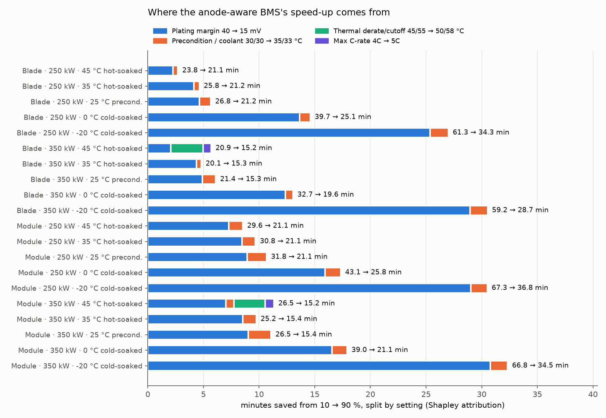

# Ablation: which setting makes the anode-aware BMS faster?

The two BMS strategies in `ev_pack/pack_sim.py` differ in four setting groups, so the original comparison could not say which one causes the speed-up. This study runs the **full 2⁴ factorial**: all 16 combinations, from the standard BMS (nothing switched) to the anode-aware BMS (all four switched). That covers switching each setting on from the standard BMS, switching each off from the anode-aware BMS, and every interaction.

| Setting group | Standard | Anode-aware |
|---|---|---|
| Plating margin | 40 mV | 15 mV |
| Preconditioning target / coolant setpoint | 30 / 30 °C | 35 / 33 °C |
| Thermal derate start / cutoff | 45 / 55 °C | 50 / 58 °C |
| Max C-rate | 4C | 5C |

Cases: both packs × 250 / 350 kW DC × {25 °C preconditioned; 0 °C and −20 °C cold-soaked; 35 °C and 45 °C hot-soaked}, 10 → 90 %: 20 cases, 320 runs (`run_ablation.py`, 8 single-threaded workers). Every run kept its plating margin and stayed below its cutoff temperature: 320/320 and 320/320. Soaked packs (no preconditioning) start at the ambient temperature.

Attribution uses **Shapley values**: each setting's marginal saving, averaged over every order in which the settings could be switched on. The four shares add up exactly to the total gap, and interactions are split between the settings involved. They are allocations for these deterministic runs (one seeded simulation per case), not confidence intervals.

## Result

**In 18 of the 20 cases** (everything except 350 kW at 45 °C):
- **The plating margin explains 81–95 % of the gap.** This is the effect of the anode observer.
- **The warmer temperature settings explain the rest (5–19 %).** Preconditioned cases warm the pack to 35 °C; in soaked cases no preconditioning happens, so this group acts only through the 33 °C coolant setpoint.
- **The thermal limits and the C-rate cap contribute nothing** (at most 0.00 min). The 4C cap never binds (peak 3.41C in any run). Crossing the 45 °C derate start is not the same as being limited by it: at 25 °C preconditioned the pack passes 45 °C only after about 64 % SOC, when the charger's power limit already holds the current near 2.7C, below the roughly 3.0C the standard derate still allows at 47 °C. In cold-soaked cases the plating guard holds the current instead.

**Hot exception: 350 kW, hot-soaked at 45 °C.** Here the standard BMS spends 59 % (blade) and 42 % (module) of the session on its thermal derate, and the attribution shifts: blade 20.9 → 15.2 min: margin 36 %, thermal limits 51 %, C-rate cap 13 %, temperature settings 0 %; module 26.5 → 15.2 min: margin 62 %, thermal limits 25 %, C-rate cap 7 %, temperature settings 6 %.
- The C-rate cap matters here only through the derate: in the simulator the derated limit is (derate fraction) × (max C-rate), so a 5C cap raises the derated current too, even though peak current stays below 4C.
- The price is heat: the hottest cell reaches 53.1 / 52.6 °C (blade / module) with the relaxed limits against 49.6 / 48.8 °C. The modelled SEI exposure index is still lower (1.32 vs 1.58 for the blade) because the session is shorter.
- At 250 kW the same 45 °C start generates less heat and the thermal limits again contribute 0.

**The settings interact.** The margin alone saves more when switched on first than it costs when switched off last (blade, 350 kW, 25 °C: 5.9 vs 4.0 min). Warmer cells and a smaller margin both relax the same plating limit, so their effects overlap rather than add.



## Every case

| Case | Standard | Anode-aware | Gap | Margin | Temp. settings | Thermal | C-rate | Margin alone (from standard) | Margin removed (from anode-aware) |
|---|---|---|---|---|---|---|---|---|---|
| Blade · 250 kW · 45 °C hot-soaked | 23.8 | 21.1 | 2.7 | 2.3 | 0.4 | 0.0 | 0.0 | 2.7 | 1.8 |
| Blade · 250 kW · 35 °C hot-soaked | 25.8 | 21.2 | 4.6 | 4.1 | 0.5 | 0.0 | 0.0 | 4.6 | 3.7 |
| Blade · 250 kW · 25 °C precond. | 26.8 | 21.2 | 5.7 | 4.6 | 1.0 | 0.0 | 0.0 | 5.6 | 3.7 |
| Blade · 250 kW · 0 °C cold-soaked | 39.7 | 25.1 | 14.6 | 13.7 | 0.9 | 0.0 | 0.0 | 14.2 | 13.1 |
| Blade · 250 kW · -20 °C cold-soaked | 61.3 | 34.3 | 27.0 | 25.4 | 1.6 | 0.0 | 0.0 | 26.3 | 24.4 |
| Blade · 350 kW · 45 °C hot-soaked | 20.9 | 15.2 | 5.7 | 2.1 | -0.0 | 2.9 | 0.7 | 2.3 | 2.1 |
| Blade · 350 kW · 35 °C hot-soaked | 20.1 | 15.3 | 4.8 | 4.4 | 0.4 | 0.0 | 0.0 | 4.8 | 3.9 |
| Blade · 350 kW · 25 °C precond. | 21.4 | 15.3 | 6.1 | 4.9 | 1.2 | 0.0 | 0.0 | 5.9 | 4.0 |
| Blade · 350 kW · 0 °C cold-soaked | 32.7 | 19.6 | 13.0 | 12.4 | 0.7 | 0.0 | 0.0 | 12.7 | 12.0 |
| Blade · 350 kW · -20 °C cold-soaked | 59.2 | 28.7 | 30.5 | 28.9 | 1.6 | 0.0 | 0.0 | 29.9 | 28.0 |
| Module · 250 kW · 45 °C hot-soaked | 29.6 | 21.1 | 8.5 | 7.3 | 1.3 | 0.0 | 0.0 | 8.5 | 6.0 |
| Module · 250 kW · 35 °C hot-soaked | 30.8 | 21.1 | 9.7 | 8.5 | 1.2 | 0.0 | 0.0 | 9.6 | 7.3 |
| Module · 250 kW · 25 °C precond. | 31.8 | 21.1 | 10.7 | 8.9 | 1.7 | 0.0 | 0.0 | 10.5 | 7.4 |
| Module · 250 kW · 0 °C cold-soaked | 43.1 | 25.8 | 17.3 | 15.9 | 1.4 | 0.0 | 0.0 | 16.7 | 15.1 |
| Module · 250 kW · -20 °C cold-soaked | 67.3 | 36.8 | 30.5 | 29.0 | 1.5 | 0.0 | 0.0 | 30.1 | 28.0 |
| Module · 350 kW · 45 °C hot-soaked | 26.5 | 15.2 | 11.3 | 7.0 | 0.7 | 2.8 | 0.8 | 8.2 | 6.1 |
| Module · 350 kW · 35 °C hot-soaked | 25.2 | 15.4 | 9.7 | 8.5 | 1.2 | 0.0 | 0.0 | 9.3 | 7.8 |
| Module · 350 kW · 25 °C precond. | 26.5 | 15.4 | 11.1 | 9.0 | 2.1 | 0.0 | 0.0 | 10.2 | 7.8 |
| Module · 350 kW · 0 °C cold-soaked | 39.0 | 21.1 | 17.9 | 16.5 | 1.4 | 0.0 | 0.0 | 17.4 | 15.7 |
| Module · 350 kW · -20 °C cold-soaked | 66.8 | 34.5 | 32.3 | 30.8 | 1.5 | 0.0 | 0.0 | 31.8 | 29.8 |

Minutes, 10 → 90 %. The Shapley columns (Margin … C-rate) sum to the gap.

## What this means

Across the tested scenarios, the 15 mV margin explains most of the simulated improvement (81–95 % in 18 of 20 cases). Warmer temperature settings explain the rest. In those 18 cases the gain does not need relaxed thermal limits or a higher current cap. In the one hot, high-power condition tested (350 kW, 45 °C hot-soaked) about 3 minutes of the gain does depend on them, at the cost of a hotter pack. A production version could keep the standard thermal limits and 4C cap and give up those minutes on hot days. The open question is unchanged: whether real cells and a production observer can safely hold a 15 mV margin across aging, observer error and cell spread.

Reproduce:
```bash
.venv/Scripts/python analysis/ablation/run_ablation.py --workers 8
.venv/Scripts/python analysis/ablation/report.py
```
