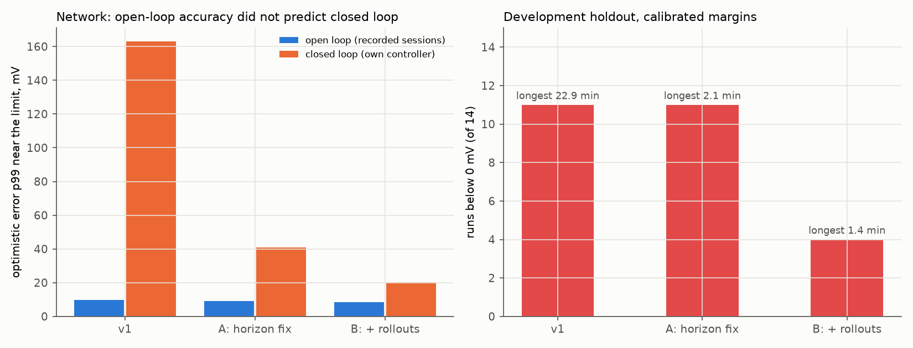
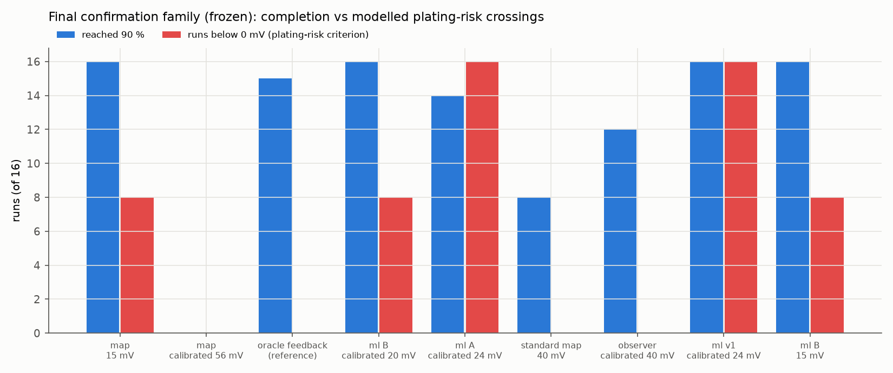

# Measurement-only anode-potential estimators: open loop vs closed loop

**Question.** Can a measurement-only estimator recover charging performance in cold, plating-limited conditions while holding a declared modelled protection target (true modelled anode ≥ 15 mV)?

**Boundaries.** Everything here is simulation. The full sodium-ion DFN is the *higher-fidelity simulation reference*, not experimental ground truth; holding out parameter cases tests generalisation *within that model family*. Below 15 mV is a violation of the selected buffer; below 0 mV crosses the model's *plating-risk criterion*. The DFN does not model sodium deposition, so a run below 0 mV is a diagnostic model result, not evidence of deposited sodium. Experimental validation of internal potential would need instrumented cells (e.g. micro-reference electrodes).

## Set-up

- **Ground truth:** the full DFN (isothermal per run), never the lookup maps. Cells vary from the nominal design: hard-carbon diffusivity ×0.6/1/1.6, anode reaction rate ×0.5/1/2, electrolyte conductivity ×0.7/1/1.3 (27 combinations), at 0, 10 and 25 °C.
- **Splits:** 20 training combinations; 7 **development holdout** combinations ([(1.6, 0.5, 0.7), (0.6, 2.0, 1.3), (0.6, 0.5, 1.3), (1.0, 0.5, 1.3), (0.6, 1.0, 0.7), (1.0, 2.0, 0.7), (0.6, 0.5, 0.7)]). The development holdout was inspected and its failures motivated the fixes below, so it is *not* a final test. A separate **final confirmation family**: 8 interior combinations (×0.8/1.3, ×0.7/1.4, ×0.85/1.15) at [5.0, 0.0] °C (5 °C never used before), simulated only after the freeze below.
- **Estimators** (inputs: measured voltage, current, temperature, declared initial SOC): (a) **map**, the nominal lookup map at the coulomb-counted SOC, which is what the pack BMS does; (b) **observer**, anode polarisation with a first-order lag plus an online gain fitted to the voltage error (recursive least squares); (c) **ml**, a small MLP (32-32) predicting the correction to the map from causal history features (exponential filters of current and voltage residual).
- **Causality:** at each 2 s decision every candidate current is fed to the estimator explicitly; inputs are measurements available before the decision; the target is the anode potential at the end of the 2 s step under that candidate; the terminal voltage of a candidate is predicted by the estimator's own model, never read from the DFN before choosing.
- **Calibration:** margin = 15 mV + the 99th percentile of the estimator's optimistic error (estimate − truth) while the true anode is below 50 mV, on a calibration set from training cells only (out-of-fold for ml).
- **Closed loop:** each controller charges the DFN live: every 2 s it picks the highest current (≤ 3.4C) its estimator says keeps the anode ≥ margin and voltage ≤ 4.3 V. The evaluator reads the true state and never corrects the controller. Stop at 90 % (true SOC window), a 5 min stall, or 2.5 h. *Oracle feedback* uses the true previous anode potential (not measurable) as a reference.

## 1. Open loop looked good; closed loop did not (v1)

| Version | Estimator | Development holdout: optimistic error p95 / p99 / max near the limit | Bias | Calibration set p99 | Calibrated margin |
|---|---|---|---|---|---|
| v1 (ramp-sampled open-loop data) | map | 36.0 / 43.2 / 142.3 mV | +9.7 mV | 39.0 mV | 54.0 mV |
| v1 (ramp-sampled open-loop data) | observer (lag 2 s) | 28.1 / 35.1 / 84.8 mV | +7.5 mV | 32.3 mV | 47.3 mV |
| v1 (ramp-sampled open-loop data) | ml | 4.4 / 9.9 / 44.1 mV | -0.2 mV | 8.5 mV | 23.5 mV |
| A (step-aligned open-loop data) | map | 36.4 / 43.1 / 50.4 mV | +9.9 mV | 39.1 mV | 54.1 mV |
| A (step-aligned open-loop data) | observer (lag 2 s) | 27.8 / 34.6 / 48.7 mV | +7.2 mV | 31.9 mV | 46.9 mV |
| A (step-aligned open-loop data) | ml | 4.1 / 9.2 / 45.5 mV | -0.1 mV | 8.8 mV | 23.8 mV |
| B (A + training-cell rollouts) | map | 36.4 / 43.1 / 50.4 mV | +9.9 mV | 40.8 mV | 55.8 mV |
| B (A + training-cell rollouts) | observer (lag 60 s) | 31.5 / 46.8 / 94.3 mV | +7.8 mV | 25.5 mV | 40.5 mV |
| B (A + training-cell rollouts) | ml | 3.6 / 8.5 / 38.2 mV | -0.3 mV | 4.9 mV | 19.9 mV |

Open loop (predicting along recorded sessions), the network looked far better than the map and observer. **In closed loop on the development holdout, v1's optimistic error reached a p99 of 163 mV**, against 10 mV open loop: an estimator with good open-loop accuracy developed sustained optimistic error on trajectories its own controller created, letting the modelled anode potential stay below the plating-risk criterion.

### Development holdout, v1 (all controllers)

| Controller | Reached 90 % | Runs below 15 mV | Runs below 0 mV | Longest below 0 mV | Worst modelled anode | Optimistic error p99 near limit | Median 10→90 % |
|---|---|---|---|---|---|---|---|
| map, 15 mV | 14/14 | 10 | 9 | 77.9 min | -34.2 mV | 49.6 mV | 81 min |
| map, calibrated 54 mV | 0/14 (7 time limit, 7 stalled) | 6 | 0 | 0.0 min | 4.1 mV | 49.8 mV | — |
| oracle feedback (reference) | 10/14 (4 time limit) | 14 | 0 | 0.0 min | 9.7 mV | 10.8 mV | 71 min |
| observer, 15 mV | 14/14 | 10 | 8 | 21.7 min | -23.2 mV | 35.2 mV | 61 min |
| standard map, 40 mV | 7/14 (6 time limit, 1 plant solver failure) | 8 | 8 | 5.2 min | -10.2 mV | 48.8 mV | 84 min |
| observer, calibrated 47 mV | 3/14 (11 time limit) | 8 | 0 | 0.0 min | 3.2 mV | 42.9 mV | 93 min |
| ml, calibrated 24 mV | 10/14 (2 time limit, 2 plant solver failure) | 14 | 11 | 22.9 min | -130.4 mV | 162.9 mV | 62 min |
| ml, 15 mV | 13/14 (1 plant solver failure) | 14 | 14 | 24.3 min | -135.3 mV | 155.4 mV | 70 min |

## 2. Two candidate causes, isolated one at a time

1. **Decision-horizon mismatch (fix A).** The v1 training sessions were solved in one go with 1 s current ramps and sampled at the switch instants, so each label was the anode potential halfway through a current change, and the 'measured' voltage came from the same instant. The closed loop holds a current for 2 s and reads the end of the step. Fix A regenerates the *same* profiles (same seeds) by stepping the DFN exactly as the closed loop does; coverage is unchanged.
2. **Training coverage (fix B).** Open-loop training sessions at 0 °C mostly hit the voltage limit within minutes at high current; in closed loop the controller spends hours at low current near full charge. Fix B is **DAgger-inspired closed-loop data aggregation** (one bounded iteration): run controllers in the loop on *training cells only* (160 rollouts: map 15 mV, network A at 15 and 25 mV, observer 15 mV), aggregate with the open-loop data, refit, and calibrate the margin on out-of-fold errors from those rollouts. Unlike original DAgger it aggregates DFN anode labels for an estimator, not expert actions, so its guarantees do not transfer.

### Development holdout, network versions (14 runs each)

| Controller | Reached 90 % | Runs below 15 mV | Runs below 0 mV | Longest below 0 mV | Worst modelled anode | Optimistic error p99 near limit | Median 10→90 % |
|---|---|---|---|---|---|---|---|
| ml, calibrated 24 mV | 10/14 (2 time limit, 2 plant solver failure) | 14 | 11 | 22.9 min | -130.4 mV | 162.9 mV | 62 min |
| ml, 15 mV | 13/14 (1 plant solver failure) | 14 | 14 | 24.3 min | -135.3 mV | 155.4 mV | 70 min |
| ml A, 15 mV | 12/14 (2 plant solver failure) | 14 | 12 | 3.7 min | -56.6 mV | 45.2 mV | 68 min |
| ml A, calibrated 24 mV | 10/14 (2 time limit, 2 plant solver failure) | 13 | 11 | 2.1 min | -50.3 mV | 40.7 mV | 86 min |
| ml B, 15 mV | 10/14 (2 time limit, 2 plant solver failure) | 14 | 4 | 2.0 min | -14.7 mV | 18.8 mV | 74 min |
| ml B, calibrated 20 mV | 10/14 (4 time limit) | 11 | 4 | 1.4 min | -10.1 mV | 20.3 mV | 83 min |



Fix A shrank the closed-loop optimistic tail and the depth and duration of crossings sharply but not their number; fix B reduced the number of crossings as well. Both causes contributed. Because the development holdout guided these fixes, it cannot confirm them.

## 3. Final confirmation on a frozen, untouched family

Before any final-family run existed, `freeze_manifest.json` recorded SHA-256 hashes of all three network versions, their calibration files and the scripts, the controllers and margins, the cases and the stopping rules (frozen 2026-10-21 00:59:27). Check at report time: **unchanged**.

| Controller | Reached 90 % | Runs below 15 mV | Runs below 0 mV | Longest below 0 mV | Worst modelled anode | Optimistic error p99 near limit | Median 10→90 % |
|---|---|---|---|---|---|---|---|
| map, 15 mV | 16/16 | 10 | 8 | 19.4 min | -16.4 mV | 31.6 mV | 81 min |
| map, calibrated 56 mV | 0/16 (16 stalled) | 0 | 0 | 0.0 min | 25.1 mV | 31.3 mV | — |
| oracle feedback (reference) | 15/16 (1 plant solver failure) | 16 | 0 | 0.0 min | 10.6 mV | 3.1 mV | 65 min |
| ml B, calibrated 20 mV | 16/16 | 15 | 8 | 0.7 min | -8.2 mV | 22.6 mV | 87 min |
| ml A, calibrated 24 mV | 14/16 (2 plant solver failure) | 16 | 16 | 2.3 min | -39.3 mV | 36.1 mV | 71 min |
| standard map, 40 mV | 8/16 (8 time limit) | 6 | 0 | 0.0 min | 8.9 mV | 30.1 mV | 127 min |
| observer, calibrated 40 mV | 12/16 (4 time limit) | 0 | 0 | 0.0 min | 21.9 mV | 18.1 mV | 139 min |
| ml v1, calibrated 24 mV | 16/16 | 16 | 16 | 24.2 min | -120.3 mV | 145.8 mV | 101 min |
| ml B, 15 mV | 16/16 | 16 | 8 | 0.8 min | -8.8 mV | 21.8 mV | 79 min |



### Reading the final family

- **Network v1 (frozen, open-loop trained):** 16 of 16 runs below 0 mV, worst -120 mV, closed-loop optimistic p99 146 mV.
- **Network B (frozen, aggregated):** 8 of 16 runs below 0 mV, worst -8 mV, longest 0.7 min, p99 23 mV; reached 90 % in 16 of 16.
- **Standard map at 40 mV:** 0 of 16 below 0 mV, worst 9 mV; reached 90 % in 8. **Map at 15 mV (the pack BMS method):** 8 below 0 mV, worst -16 mV.
- **Oracle feedback reference:** 0 below 0 mV, reached 90 % in 15, median 65 min.

### Verdict

**Not yet.** No measurement-only estimator recovered charging performance while holding the declared target on the frozen family. Closed-loop aggregation (B) removed most of the severity (worst crossing -120 → -8 mV, longest 24 → 0.7 min) and completed every run, but 8 of 16 runs still crossed 0 mV briefly: its margin, calibrated on training-cell rollouts (p99 4.9 mV), underestimated the tail on unseen cells (p99 23 mV). The calibrated observer was the only measurement-only controller that held both 15 mV and 0 mV here, at a much longer charge. A conservative map margin is safe but stalls. The protection–speed trade-off is set by how well the estimator's error tail transfers to unseen cells.

## What this establishes and what it doesn't

- **Establishes:** open-loop accuracy is not evidence of closed-loop safety for a charging estimator; a decision-horizon mismatch and training coverage both caused optimistic closed-loop error here; one round of closed-loop data aggregation on training cells changed the result on a frozen family of unseen parameter cases (numbers above).
- **Doesn't establish:** behaviour of a real cell (the DFN is a simulation reference with assumed parameters), any sodium deposition, generalisation beyond this model family, or variability across seeds (one run per case). The calibration is empirical: a margin that held on these cases is not a safety guarantee.
- **Also true:** the nominal-map controllers are not a safe baseline on off-nominal cells. On the development holdout the standard 40 mV controller crossed 0 mV in 8 of 14 runs; on the milder final family it did not cross but reached 90 % in only 8 of 16 within 2.5 h. The 15 mV map controller (the pack BMS method) crossed in both.

## Reproduce

```bash
cd analysis/estimator
../../.venv/Scripts/python generate.py && ../../.venv/Scripts/python train_eval.py && ../../.venv/Scripts/python closed_loop.py   # v1 (preserved in v1/)
../../.venv/Scripts/python generate_step.py && ../../.venv/Scripts/python train_eval.py --set sessions_step.jsonl:data_step:openloop --tag A
../../.venv/Scripts/python closed_loop.py --preset A_dev --out closed_loop_A.jsonl
../../.venv/Scripts/python closed_loop.py --preset rollout --out rollouts.jsonl && ../../.venv/Scripts/python freeze.py index
../../.venv/Scripts/python train_eval.py --set sessions_step.jsonl:data_step:openloop --set sessions_rollout.jsonl:data_rollout:rollout --tag B
../../.venv/Scripts/python closed_loop.py --preset B_dev --out closed_loop_B.jsonl
../../.venv/Scripts/python freeze.py freeze && ../../.venv/Scripts/python closed_loop.py --preset final --out closed_loop_final.jsonl
../../.venv/Scripts/python report.py
```
