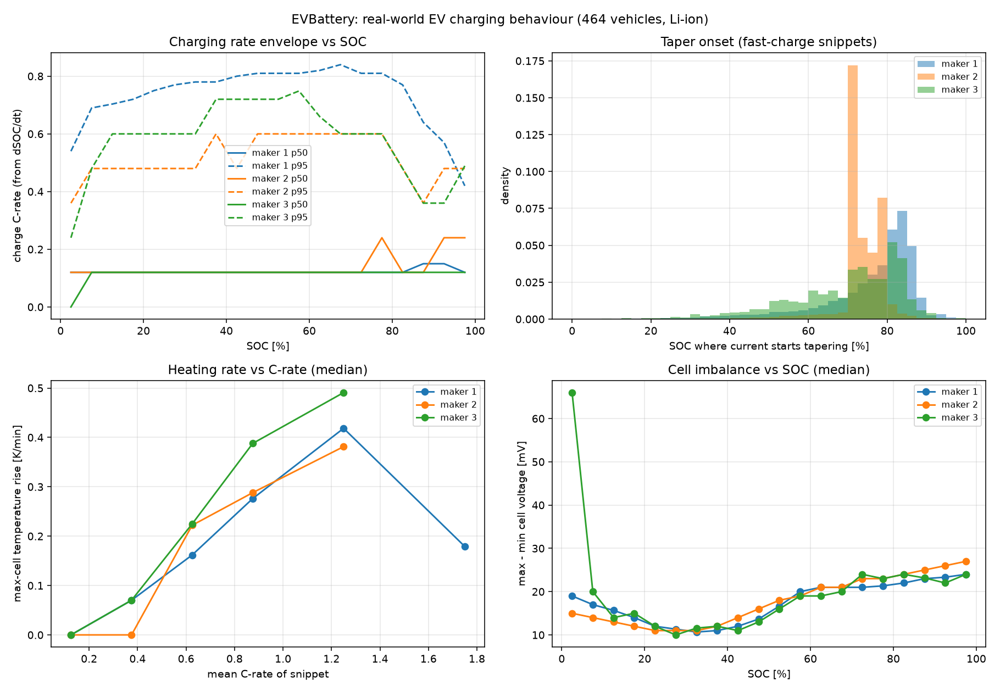

# EVBattery dataset: real-world realism targets

**Source.** He et al., *EVBattery: A Large-Scale Electric Vehicle Dataset for Battery Health and Capacity Estimation* (arXiv 2201.12358), CC BY-NC-SA. Three manufacturers, **1,278,277 charging snippets** (128 samples at 10 s each), of which 1,203,971 contain charging current. The cars are lithium-ion, and the authors perturbed and anonymised the values. So these numbers are **behavioural benchmarks**, not sodium-ion parameters.

**Safe loading.** The `.pkl` files are legacy `torch.save` containers. Static opcode inspection (`inspect_pickles.py`) showed that the payload references only numpy array/scalar reconstruction, `OrderedDict` and `_codecs.encode`. `safe_load.py` allows exactly those, refuses everything else (self-test: an `os.system` pickle is rejected), and streams straight from the `.tar.gz` without extracting anything. **0 files were refused.**

Columns, taken from the authors' code: `volt, current (charging negative), soc, max_single_volt, min_single_volt, max_temp, min_temp, timestamp`. C-rate is computed from dSOC/dt, so no pack capacity is needed.



## Targets (`targets.json`)

| Behaviour | Real fleet (all makers) |
|---|---|
| Fast-charge C-rate envelope (p95) | 0.5–0.8C. Peaks at 40–75% SOC, falls to 0.4–0.5C above 85% SOC |
| **Taper onset SOC** (fast-charge snippets) | **median 77%**, IQR 71–83%, p90 86% |
| Max-cell heating rate | 0.04 K/min at 0.25–0.5C → 0.18 at 0.5–0.75C → 0.28 at 0.75–1C → **0.42 at 1–1.5C** |
| Max–min cell temperature | 2.1 °C at <0.25C, **3.3–3.6 °C at ≥0.5C** |
| Max–min cell voltage | about 11 mV at 30% SOC, rising to **22–24 mV at 80–95% SOC** (p90 about 55 mV) |
| Max cell temperature | p50 26 °C, p95 39 °C, p99 44 °C |

**Anomaly vehicles** (fire or lithium-plating reports) compared with normal ones, above 80% SOC:

| | normal | anomaly |
|---|---|---|
| Cell voltage spread p50 / **p90** | 23 / **45 mV** | 31 / **127 mV** |
| Max temperature p50 / p90 | 27 / 37 °C | 31 / 40 °C |

**Imbalance at high SOC is the clearest real-world warning sign.** At p90 the anomaly cars have nearly 3× the voltage spread.

## Simulation vs real (`sim_vs_real.json`, after calibration)

The comparison led to three calibrations in `ev_pack/pack_sim.py`:
1. **Tab, weld and busbar resistance**, which the electrochemistry omits. Pack resistance went from 31 to about 72 mΩ, in line with modern 800 V packs.
2. **±25% cell-to-cold-plate contact variation.** The blade pack's ΔT was 0.5–1.1 °C, which is unrealistically uniform. It is now 1.5–4 °C, matching the fleet's 3.3–3.6 °C.
3. **1% initial cell SOC imbalance** instead of 0.3%.

What remains different, and why:
- **Heating rate:** the sim gives 0.13 K/min at 1.1C, against about 0.42 K/min for the fleet. The fleet is older, higher-resistance 400 V packs. At 1.6% loss and about 1 t of cells, the 800 V Na-ion pack heats more slowly. At 3C the sim reaches about 1 K/min.
- **Taper onset:** the optimized BMS at 350 kW holds full power to 75% SOC, about the fleet median, but at roughly 4× the fleet's C-rate. That's the point of the design.
- **Cell voltage spread at high SOC:** the sim gives 4–12 mV against 23 mV for the fleet. The NVPF / hard-carbon OCV is very flat above 80% SOC (about 1.6 mV per % SOC, versus about 7 for NMC). **Consequence: a Na-ion BMS cannot rely on cell-voltage spread to catch the imbalance that preceded failures in this fleet.** It needs model-based SOC estimation or impedance and differential-capacity methods instead.

Reproduce:
```bash
.venv/Scripts/python -I analysis/evbattery/analyze.py    # ~13 min, streams all archives
.venv/Scripts/python analysis/evbattery/targets.py       # targets.json, figure, sim comparison
```
