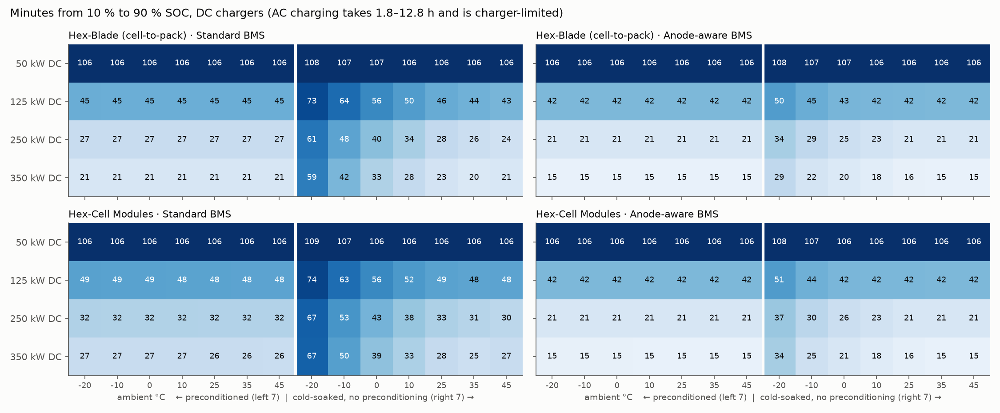
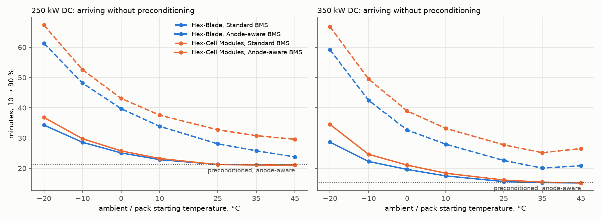
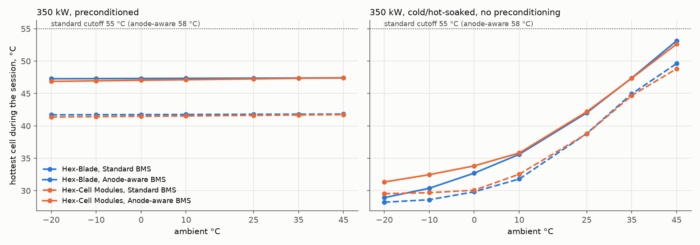

# Full test matrix: every charger × every starting condition

**336 charging sessions**, each 10 % → 90 % SOC: 2 packs × 6 chargers × 7 ambient temperatures (−20, −10, 0, 10, 25, 35, 45 °C) × preconditioned or not × 2 BMS strategies.
Run with `analysis/matrix/run_matrix.py` (8 single-threaded worker processes, ~4 min; every result is saved as it finishes, so a crash can resume). Raw data: `matrix.csv` (one row per session), `results.json` (with charge curves).

## Verdict

- **All 336 sessions pass all 10 checks** (3,360 checks). **0 violations** in 664 cross-run consistency comparisons.
- The matrix caught one real bug on its first run: with a cold-soaked pack the power limit used the previous time step's pack voltage, which climbs fast in the cold, so the pack briefly drew **3–7 % more than the charger's rating** (30 sessions). Fixed in `ev_pack/pack_sim.py` (the current is re-solved until power ≤ rating); a regression test was added and the viewer data re-exported.
- What limits charging, by session: Charger power 277, Na-plating guard 58, Thermal derate 1.
- Hottest cell in any session: **53.1 °C** (blade, 350 kW DC, 45 °C, no preconditioning, Anode-aware BMS). Cutoffs are 55 °C (standard) and 58 °C (anode-aware).
- Plating margin held in every step of every session: lowest anode potential 40.0 mV (standard, limit 40) and 15.0 mV (anode-aware, limit 15). Highest pack voltage 882 V (limit 920 V).

### Checks on every session

| Check | Passed |
|---|---|
| Simulation completes without an error | 336 / 336 |
| Reaches 90 % SOC | 336 / 336 |
| Anode never below the sodium-plating margin (40 / 15 mV) | 336 / 336 |
| Hottest cell stays below the BMS cutoff (55 / 58 °C) | 336 / 336 |
| Pack power never above the charger rating × efficiency (+0.5 %) | 336 / 336 |
| DC current never above the charger's current limit | 336 / 336 |
| Pack voltage never above the charger's 920 V limit | 336 / 336 |
| Energy delivered between stored energy and stored + 15 % losses | 336 / 336 |
| No NaN / infinite values in any output | 336 / 336 |
| State of charge never goes backwards | 336 / 336 |

### Cross-run consistency

| Comparison | Pairs tested | Violations |
|---|---|---|
| A more powerful charger is never slower (same pack, conditions, BMS) | 280 | 0 |
| At ≤ 10 °C, preconditioning is never slower than arriving cold | 96 | 0 |
| The anode-aware BMS is never slower than the standard BMS | 168 | 0 |
| Without preconditioning, a warmer pack (−20 → 25 °C) is never slower | 96 | 0 |
| Preconditioned sessions vary < 5 % across ambient temperatures | 24 | 0 |

## What the numbers say

1. **Preconditioned, the pack charges the same at any ambient.** 350 kW, 10→90 %: blade 15.3 min (anode-aware) / 21.4 min (standard); module 15.4 / 26.5 min.
2. **Skipping preconditioning in the cold is the biggest single penalty.** At −20 °C a cold-soaked blade pack needs 28.7 min (anode-aware) or 59.2 min (standard) on 350 kW, against 15.3 preconditioned. The sodium-plating guard limits current until the coolant heater (7 kW) has warmed the cells.
3. **The anode-aware BMS roughly halves the cold-soak penalty.** Blade at 0 °C, 350 kW: 19.6 vs 32.7 min.
4. **A faster charger pays off more with the anode-aware BMS.** Going from 250 to 350 kW (+40 % power) cuts the blade pack's 10→90 % time by 28 % with the anode-aware BMS but only 20 % with the standard one (module: 27 % vs 17 %): the standard BMS tapers early, so the extra charger power goes unused above ~65 % SOC.
5. **AC and 50 kW charging are charger-limited everywhere**: the pack, BMS and temperature change the time by under 3 %. Only a cold-soaked −20 °C start adds a few minutes.
6. **Hot-soaked packs (35–45 °C, no preconditioning) charge slightly faster** (warm cells accept more current) but run hottest: up to 53.1 °C. With the standard BMS at 350 kW and 45 °C the thermal derate limits the current for part of the session (blade 59 % of the time, module 42 %), which is why those two are slower than the 35 °C case.

## Limits of this test

- **Preconditioning is modelled as already done**: the pack starts at the strategy's target (30 / 35 °C). The energy and time needed to precondition before arriving are not counted, and ambient only reaches the pack through a weak 0.01 W/K leak, so check 5 above passes by construction.
- **−20 °C sits at the edge of the cell model.** Five of the DFN cell simulations at −20 °C (0.05C, 3.5C, 4C, 5C and 6C) did not converge when the charge maps were built (`ev_pack/data/na_cell_maps.npz`, 91 of 96 complete); those points are filled from neighbours. Treat cold-soaked −20 °C times as lower-confidence.
- The thermal model, heater power (7 kW) and chiller power (25 kW) are engineering estimates calibrated against fleet data (see `analysis/evbattery/REPORT.md`), not a validated vehicle thermal system.

## Every value

Format: **preconditioned / cold-soaked**. Times in minutes, or `h mm` above 100 min.

#### Time 10 % → 90 %

**Hex-Blade (cell-to-pack) · Standard BMS** (preconditioned / cold-soaked)

| Charger | -20 °C | -10 °C | 0 °C | 10 °C | 25 °C | 35 °C | 45 °C |
|---|---|---|---|---|---|---|---|
| 7 kW AC | 12 h 49 / 12 h 52 | 12 h 49 / 12 h 50 | 12 h 49 / 12 h 50 | 12 h 49 / 12 h 49 | 12 h 49 / 12 h 49 | 12 h 49 / 12 h 49 | 12 h 49 / 12 h 49 |
| 15 kW AC | 5 h 56 / 5 h 58 | 5 h 56 / 5 h 56 | 5 h 56 / 5 h 56 | 5 h 56 / 5 h 56 | 5 h 56 / 5 h 56 | 5 h 56 / 5 h 56 | 5 h 56 / 5 h 55 |
| 50 kW DC | 1 h 46 / 1 h 48 | 1 h 46 / 1 h 47 | 1 h 46 / 1 h 47 | 1 h 46 / 1 h 46 | 1 h 46 / 1 h 46 | 1 h 46 / 1 h 46 | 1 h 46 / 1 h 46 |
| 125 kW DC | 45.0 / 72.9 | 45.0 / 64.1 | 44.9 / 56.1 | 44.9 / 50.3 | 44.9 / 45.7 | 44.8 / 44.0 | 44.8 / 42.7 |
| 250 kW DC | 26.9 / 61.3 | 26.9 / 48.2 | 26.9 / 39.7 | 26.9 / 33.9 | 26.8 / 28.1 | 26.8 / 25.8 | 26.8 / 23.8 |
| 350 kW DC | 21.4 / 59.2 | 21.4 / 42.5 | 21.4 / 32.7 | 21.4 / 28.0 | 21.4 / 22.6 | 21.4 / 20.1 | 21.3 / 20.9 |

**Hex-Blade (cell-to-pack) · Anode-aware BMS** (preconditioned / cold-soaked)

| Charger | -20 °C | -10 °C | 0 °C | 10 °C | 25 °C | 35 °C | 45 °C |
|---|---|---|---|---|---|---|---|
| 7 kW AC | 12 h 49 / 12 h 52 | 12 h 49 / 12 h 50 | 12 h 49 / 12 h 49 | 12 h 49 / 12 h 49 | 12 h 49 / 12 h 49 | 12 h 49 / 12 h 49 | 12 h 49 / 12 h 49 |
| 15 kW AC | 5 h 55 / 5 h 58 | 5 h 55 / 5 h 56 | 5 h 55 / 5 h 56 | 5 h 55 / 5 h 56 | 5 h 55 / 5 h 56 | 5 h 55 / 5 h 55 | 5 h 55 / 5 h 55 |
| 50 kW DC | 1 h 46 / 1 h 48 | 1 h 46 / 1 h 47 | 1 h 46 / 1 h 47 | 1 h 46 / 1 h 46 | 1 h 46 / 1 h 46 | 1 h 46 / 1 h 46 | 1 h 46 / 1 h 46 |
| 125 kW DC | 42.0 / 50.3 | 42.0 / 45.2 | 42.0 / 42.7 | 42.0 / 42.4 | 42.0 / 42.1 | 42.0 / 42.0 | 42.0 / 41.9 |
| 250 kW DC | 21.2 / 34.3 | 21.2 / 28.6 | 21.2 / 25.1 | 21.2 / 22.9 | 21.2 / 21.3 | 21.2 / 21.2 | 21.2 / 21.1 |
| 350 kW DC | 15.3 / 28.7 | 15.3 / 22.3 | 15.3 / 19.6 | 15.3 / 17.5 | 15.3 / 15.6 | 15.3 / 15.3 | 15.3 / 15.2 |

**Hex-Cell Modules · Standard BMS** (preconditioned / cold-soaked)

| Charger | -20 °C | -10 °C | 0 °C | 10 °C | 25 °C | 35 °C | 45 °C |
|---|---|---|---|---|---|---|---|
| 7 kW AC | 12 h 48 / 12 h 51 | 12 h 48 / 12 h 48 | 12 h 48 / 12 h 48 | 12 h 48 / 12 h 48 | 12 h 48 / 12 h 48 | 12 h 48 / 12 h 48 | 12 h 48 / 12 h 48 |
| 15 kW AC | 5 h 55 / 5 h 57 | 5 h 55 / 5 h 55 | 5 h 55 / 5 h 55 | 5 h 55 / 5 h 55 | 5 h 55 / 5 h 55 | 5 h 55 / 5 h 55 | 5 h 55 / 5 h 55 |
| 50 kW DC | 1 h 46 / 1 h 49 | 1 h 46 / 1 h 47 | 1 h 46 / 1 h 46 | 1 h 46 / 1 h 46 | 1 h 46 / 1 h 46 | 1 h 46 / 1 h 46 | 1 h 46 / 1 h 46 |
| 125 kW DC | 48.9 / 74.5 | 48.7 / 63.5 | 48.6 / 56.1 | 48.5 / 51.5 | 48.3 / 48.6 | 48.2 / 47.9 | 48.1 / 48.1 |
| 250 kW DC | 32.2 / 67.3 | 32.1 / 52.6 | 32.0 / 43.1 | 31.9 / 37.6 | 31.8 / 32.7 | 31.7 / 30.8 | 31.6 / 29.6 |
| 350 kW DC | 26.8 / 66.8 | 26.8 / 49.5 | 26.7 / 39.0 | 26.6 / 33.2 | 26.5 / 27.8 | 26.4 / 25.2 | 26.4 / 26.5 |

**Hex-Cell Modules · Anode-aware BMS** (preconditioned / cold-soaked)

| Charger | -20 °C | -10 °C | 0 °C | 10 °C | 25 °C | 35 °C | 45 °C |
|---|---|---|---|---|---|---|---|
| 7 kW AC | 12 h 48 / 12 h 50 | 12 h 48 / 12 h 48 | 12 h 48 / 12 h 48 | 12 h 48 / 12 h 48 | 12 h 48 / 12 h 48 | 12 h 48 / 12 h 48 | 12 h 48 / 12 h 48 |
| 15 kW AC | 5 h 55 / 5 h 57 | 5 h 55 / 5 h 55 | 5 h 55 / 5 h 55 | 5 h 55 / 5 h 55 | 5 h 55 / 5 h 55 | 5 h 55 / 5 h 55 | 5 h 55 / 5 h 55 |
| 50 kW DC | 1 h 46 / 1 h 48 | 1 h 46 / 1 h 47 | 1 h 46 / 1 h 46 | 1 h 46 / 1 h 46 | 1 h 46 / 1 h 46 | 1 h 46 / 1 h 46 | 1 h 46 / 1 h 46 |
| 125 kW DC | 41.9 / 50.6 | 41.9 / 44.3 | 41.9 / 42.5 | 41.9 / 42.2 | 41.9 / 42.0 | 41.9 / 41.9 | 41.9 / 41.8 |
| 250 kW DC | 21.1 / 36.8 | 21.1 / 29.8 | 21.1 / 25.8 | 21.1 / 23.2 | 21.1 / 21.2 | 21.1 / 21.1 | 21.1 / 21.1 |
| 350 kW DC | 15.5 / 34.5 | 15.5 / 24.6 | 15.5 / 21.1 | 15.4 / 18.4 | 15.4 / 16.1 | 15.4 / 15.4 | 15.4 / 15.2 |

#### Time 10 % → 80 %

**Hex-Blade (cell-to-pack) · Standard BMS** (preconditioned / cold-soaked)

| Charger | -20 °C | -10 °C | 0 °C | 10 °C | 25 °C | 35 °C | 45 °C |
|---|---|---|---|---|---|---|---|
| 7 kW AC | 11 h 04 / 11 h 07 | 11 h 04 / 11 h 04 | 11 h 04 / 11 h 04 | 11 h 04 / 11 h 04 | 11 h 04 / 11 h 04 | 11 h 04 / 11 h 04 | 11 h 04 / 11 h 04 |
| 15 kW AC | 5 h 07 / 5 h 09 | 5 h 07 / 5 h 08 | 5 h 07 / 5 h 07 | 5 h 07 / 5 h 07 | 5 h 07 / 5 h 07 | 5 h 07 / 5 h 07 | 5 h 07 / 5 h 07 |
| 50 kW DC | 91.7 / 94.0 | 91.7 / 92.7 | 91.7 / 92.2 | 91.7 / 92.0 | 91.7 / 91.7 | 91.7 / 91.6 | 91.7 / 91.6 |
| 125 kW DC | 37.4 / 57.3 | 37.4 / 50.2 | 37.4 / 44.4 | 37.4 / 40.3 | 37.4 / 37.8 | 37.4 / 36.9 | 37.3 / 36.4 |
| 250 kW DC | 20.8 / 46.2 | 20.8 / 35.3 | 20.8 / 28.9 | 20.8 / 24.8 | 20.8 / 21.5 | 20.8 / 20.2 | 20.8 / 19.1 |
| 350 kW DC | 16.0 / 44.4 | 16.0 / 30.3 | 16.0 / 22.8 | 16.0 / 19.9 | 16.0 / 16.7 | 16.0 / 15.2 | 16.0 / 16.6 |

**Hex-Blade (cell-to-pack) · Anode-aware BMS** (preconditioned / cold-soaked)

| Charger | -20 °C | -10 °C | 0 °C | 10 °C | 25 °C | 35 °C | 45 °C |
|---|---|---|---|---|---|---|---|
| 7 kW AC | 11 h 04 / 11 h 07 | 11 h 04 / 11 h 04 | 11 h 04 / 11 h 04 | 11 h 04 / 11 h 04 | 11 h 04 / 11 h 04 | 11 h 04 / 11 h 04 | 11 h 04 / 11 h 04 |
| 15 kW AC | 5 h 07 / 5 h 09 | 5 h 07 / 5 h 07 | 5 h 07 / 5 h 07 | 5 h 07 / 5 h 07 | 5 h 07 / 5 h 07 | 5 h 07 / 5 h 07 | 5 h 07 / 5 h 07 |
| 50 kW DC | 91.6 / 93.8 | 91.6 / 92.6 | 91.6 / 92.2 | 91.6 / 91.9 | 91.6 / 91.7 | 91.6 / 91.6 | 91.6 / 91.5 |
| 125 kW DC | 36.2 / 43.0 | 36.2 / 38.9 | 36.2 / 37.0 | 36.2 / 36.6 | 36.2 / 36.4 | 36.2 / 36.2 | 36.2 / 36.2 |
| 250 kW DC | 18.3 / 27.9 | 18.3 / 23.2 | 18.3 / 20.8 | 18.3 / 19.4 | 18.3 / 18.4 | 18.3 / 18.3 | 18.3 / 18.2 |
| 350 kW DC | 13.2 / 23.1 | 13.2 / 17.7 | 13.2 / 15.9 | 13.2 / 14.6 | 13.2 / 13.5 | 13.2 / 13.2 | 13.2 / 13.1 |

**Hex-Cell Modules · Standard BMS** (preconditioned / cold-soaked)

| Charger | -20 °C | -10 °C | 0 °C | 10 °C | 25 °C | 35 °C | 45 °C |
|---|---|---|---|---|---|---|---|
| 7 kW AC | 11 h 02 / 11 h 05 | 11 h 02 / 11 h 03 | 11 h 02 / 11 h 03 | 11 h 02 / 11 h 03 | 11 h 02 / 11 h 02 | 11 h 02 / 11 h 02 | 11 h 02 / 11 h 02 |
| 15 kW AC | 5 h 06 / 5 h 08 | 5 h 06 / 5 h 07 | 5 h 06 / 5 h 06 | 5 h 06 / 5 h 06 | 5 h 06 / 5 h 06 | 5 h 06 / 5 h 06 | 5 h 06 / 5 h 06 |
| 50 kW DC | 91.5 / 93.6 | 91.5 / 92.4 | 91.5 / 92.0 | 91.5 / 91.7 | 91.5 / 91.5 | 91.5 / 91.4 | 91.5 / 91.4 |
| 125 kW DC | 39.1 / 57.5 | 39.1 / 48.8 | 39.0 / 43.6 | 38.9 / 41.1 | 38.8 / 39.2 | 38.8 / 38.4 | 38.7 / 37.8 |
| 250 kW DC | 23.2 / 50.0 | 23.2 / 38.6 | 23.2 / 31.1 | 23.1 / 27.5 | 23.1 / 23.8 | 23.0 / 22.3 | 23.0 / 20.9 |
| 350 kW DC | 18.4 / 49.3 | 18.4 / 35.7 | 18.4 / 27.4 | 18.3 / 23.2 | 18.3 / 19.2 | 18.2 / 17.3 | 18.2 / 18.5 |

**Hex-Cell Modules · Anode-aware BMS** (preconditioned / cold-soaked)

| Charger | -20 °C | -10 °C | 0 °C | 10 °C | 25 °C | 35 °C | 45 °C |
|---|---|---|---|---|---|---|---|
| 7 kW AC | 11 h 02 / 11 h 05 | 11 h 02 / 11 h 03 | 11 h 02 / 11 h 03 | 11 h 02 / 11 h 02 | 11 h 02 / 11 h 02 | 11 h 02 / 11 h 02 | 11 h 02 / 11 h 02 |
| 15 kW AC | 5 h 06 / 5 h 08 | 5 h 06 / 5 h 07 | 5 h 06 / 5 h 06 | 5 h 06 / 5 h 06 | 5 h 06 / 5 h 06 | 5 h 06 / 5 h 06 | 5 h 06 / 5 h 06 |
| 50 kW DC | 91.4 / 93.6 | 91.4 / 92.4 | 91.4 / 92.0 | 91.4 / 91.7 | 91.4 / 91.5 | 91.4 / 91.4 | 91.4 / 91.3 |
| 125 kW DC | 36.2 / 43.7 | 36.2 / 38.4 | 36.2 / 36.8 | 36.2 / 36.5 | 36.2 / 36.3 | 36.2 / 36.2 | 36.2 / 36.1 |
| 250 kW DC | 18.3 / 30.7 | 18.3 / 24.5 | 18.3 / 21.4 | 18.3 / 19.7 | 18.3 / 18.4 | 18.3 / 18.3 | 18.2 / 18.2 |
| 350 kW DC | 13.3 / 28.7 | 13.3 / 19.9 | 13.3 / 17.1 | 13.3 / 15.2 | 13.3 / 13.8 | 13.3 / 13.3 | 13.3 / 13.1 |

#### Hottest cell, °C

**Hex-Blade (cell-to-pack) · Standard BMS** (preconditioned / cold-soaked)

| Charger | -20 °C | -10 °C | 0 °C | 10 °C | 25 °C | 35 °C | 45 °C |
|---|---|---|---|---|---|---|---|
| 7 kW AC | 30.0 / 29.8 | 30.0 / 29.9 | 30.0 / 29.9 | 30.0 / 29.9 | 30.0 / 30.0 | 30.1 / 35.0 | 30.1 / 44.9 |
| 15 kW AC | 30.0 / 29.9 | 30.0 / 29.9 | 30.0 / 29.9 | 30.0 / 30.0 | 30.1 / 30.1 | 30.2 / 35.0 | 30.2 / 44.9 |
| 50 kW DC | 30.9 / 29.4 | 30.9 / 29.8 | 31.0 / 30.0 | 31.0 / 30.2 | 31.1 / 30.6 | 31.1 / 35.0 | 31.2 / 45.0 |
| 125 kW DC | 33.9 / 28.3 | 34.0 / 28.6 | 34.0 / 29.2 | 34.0 / 30.0 | 34.1 / 32.4 | 34.1 / 36.7 | 34.2 / 45.0 |
| 250 kW DC | 38.6 / 28.2 | 38.6 / 28.5 | 38.6 / 29.2 | 38.6 / 30.6 | 38.7 / 35.9 | 38.7 / 41.7 | 38.7 / 48.0 |
| 350 kW DC | 41.7 / 28.2 | 41.7 / 28.6 | 41.7 / 29.8 | 41.8 / 31.8 | 41.8 / 38.8 | 41.8 / 44.9 | 41.8 / 49.6 |

**Hex-Blade (cell-to-pack) · Anode-aware BMS** (preconditioned / cold-soaked)

| Charger | -20 °C | -10 °C | 0 °C | 10 °C | 25 °C | 35 °C | 45 °C |
|---|---|---|---|---|---|---|---|
| 7 kW AC | 35.0 / 32.8 | 35.0 / 32.9 | 35.0 / 32.9 | 35.0 / 32.9 | 35.0 / 33.0 | 35.0 / 35.0 | 35.0 / 44.9 |
| 15 kW AC | 35.0 / 32.8 | 35.0 / 32.9 | 35.0 / 32.9 | 35.0 / 33.0 | 35.0 / 33.0 | 35.0 / 35.0 | 35.0 / 44.9 |
| 50 kW DC | 35.0 / 32.1 | 35.0 / 32.6 | 35.1 / 32.9 | 35.1 / 33.1 | 35.1 / 33.4 | 35.1 / 35.1 | 35.1 / 45.0 |
| 125 kW DC | 37.6 / 28.6 | 37.7 / 29.8 | 37.7 / 31.4 | 37.8 / 32.8 | 37.8 / 34.6 | 37.9 / 37.9 | 37.9 / 45.0 |
| 250 kW DC | 43.4 / 28.4 | 43.4 / 29.5 | 43.5 / 31.5 | 43.5 / 33.9 | 43.5 / 38.7 | 43.5 / 43.5 | 43.6 / 48.9 |
| 350 kW DC | 47.3 / 28.9 | 47.3 / 30.4 | 47.3 / 32.7 | 47.3 / 35.6 | 47.4 / 42.0 | 47.4 / 47.4 | 47.4 / 53.1 |

**Hex-Cell Modules · Standard BMS** (preconditioned / cold-soaked)

| Charger | -20 °C | -10 °C | 0 °C | 10 °C | 25 °C | 35 °C | 45 °C |
|---|---|---|---|---|---|---|---|
| 7 kW AC | 30.0 / 29.7 | 30.0 / 29.8 | 30.0 / 29.8 | 30.0 / 29.9 | 30.0 / 30.0 | 30.1 / 35.0 | 30.3 / 44.9 |
| 15 kW AC | 30.0 / 29.7 | 30.0 / 29.8 | 30.0 / 29.9 | 30.0 / 29.9 | 30.0 / 30.0 | 30.2 / 35.0 | 30.4 / 44.9 |
| 50 kW DC | 30.3 / 29.8 | 30.3 / 29.9 | 30.4 / 30.0 | 30.6 / 30.1 | 30.8 / 30.5 | 31.0 / 35.0 | 31.1 / 45.0 |
| 125 kW DC | 33.0 / 29.5 | 33.1 / 29.6 | 33.2 / 29.9 | 33.3 / 30.4 | 33.5 / 32.0 | 33.6 / 36.0 | 33.8 / 45.0 |
| 250 kW DC | 38.0 / 29.5 | 38.0 / 29.7 | 38.1 / 29.9 | 38.2 / 31.1 | 38.3 / 35.8 | 38.4 / 41.1 | 38.5 / 47.3 |
| 350 kW DC | 41.4 / 29.5 | 41.4 / 29.7 | 41.5 / 30.1 | 41.5 / 32.5 | 41.6 / 38.8 | 41.7 / 44.7 | 41.7 / 48.8 |

**Hex-Cell Modules · Anode-aware BMS** (preconditioned / cold-soaked)

| Charger | -20 °C | -10 °C | 0 °C | 10 °C | 25 °C | 35 °C | 45 °C |
|---|---|---|---|---|---|---|---|
| 7 kW AC | 35.0 / 32.7 | 35.0 / 32.7 | 35.0 / 32.8 | 35.0 / 32.9 | 35.0 / 33.0 | 35.0 / 35.0 | 35.0 / 44.9 |
| 15 kW AC | 35.0 / 32.7 | 35.0 / 32.8 | 35.0 / 32.8 | 35.0 / 32.9 | 35.0 / 33.0 | 35.0 / 35.0 | 35.0 / 44.9 |
| 50 kW DC | 35.0 / 32.7 | 35.0 / 32.9 | 35.0 / 33.0 | 35.0 / 33.1 | 35.0 / 33.4 | 35.0 / 35.0 | 35.0 / 45.0 |
| 125 kW DC | 36.7 / 30.6 | 36.8 / 31.7 | 36.9 / 32.9 | 37.0 / 33.7 | 37.1 / 34.8 | 37.2 / 37.2 | 37.3 / 45.0 |
| 250 kW DC | 42.6 / 31.0 | 42.6 / 31.8 | 42.7 / 33.1 | 42.8 / 34.8 | 43.0 / 39.0 | 43.1 / 43.1 | 43.2 / 47.9 |
| 350 kW DC | 46.9 / 31.3 | 47.0 / 32.5 | 47.0 / 33.8 | 47.1 / 35.8 | 47.3 / 42.2 | 47.4 / 47.4 | 47.4 / 52.6 |

#### SEI aging index (equivalent hours at 25 °C; lower is better)

**Hex-Blade (cell-to-pack) · Standard BMS** (preconditioned / cold-soaked)

| Charger | -20 °C | -10 °C | 0 °C | 10 °C | 25 °C | 35 °C | 45 °C |
|---|---|---|---|---|---|---|---|
| 7 kW AC | 18.16 / 16.30 | 18.23 / 16.66 | 18.30 / 17.11 | 18.37 / 17.52 | 18.48 / 18.21 | 18.55 / 18.86 | 18.62 / 19.74 |
| 15 kW AC | 8.44 / 6.60 | 8.47 / 6.92 | 8.51 / 7.32 | 8.54 / 7.69 | 8.58 / 8.32 | 8.62 / 8.93 | 8.65 / 9.76 |
| 50 kW DC | 2.65 / 1.04 | 2.65 / 1.29 | 2.66 / 1.58 | 2.67 / 1.88 | 2.68 / 2.43 | 2.69 / 2.99 | 2.70 / 3.79 |
| 125 kW DC | 1.30 / 0.65 | 1.30 / 0.67 | 1.30 / 0.71 | 1.30 / 0.81 | 1.31 / 1.13 | 1.31 / 1.53 | 1.31 / 2.16 |
| 250 kW DC | 0.99 / 0.60 | 0.99 / 0.58 | 0.99 / 0.59 | 0.99 / 0.65 | 0.99 / 0.86 | 0.99 / 1.16 | 0.99 / 1.63 |
| 350 kW DC | 0.93 / 0.60 | 0.93 / 0.56 | 0.93 / 0.56 | 0.93 / 0.62 | 0.94 / 0.82 | 0.94 / 1.08 | 0.94 / 1.58 |

**Hex-Blade (cell-to-pack) · Anode-aware BMS** (preconditioned / cold-soaked)

| Charger | -20 °C | -10 °C | 0 °C | 10 °C | 25 °C | 35 °C | 45 °C |
|---|---|---|---|---|---|---|---|
| 7 kW AC | 22.61 / 20.03 | 22.70 / 20.48 | 22.78 / 21.03 | 22.87 / 21.56 | 23.00 / 22.36 | 23.09 / 23.09 | 23.17 / 24.05 |
| 15 kW AC | 10.57 / 8.03 | 10.61 / 8.43 | 10.65 / 8.92 | 10.69 / 9.40 | 10.74 / 10.12 | 10.78 / 10.78 | 10.82 / 11.70 |
| 50 kW DC | 3.39 / 1.18 | 3.40 / 1.48 | 3.41 / 1.83 | 3.42 / 2.20 | 3.43 / 2.83 | 3.44 / 3.44 | 3.45 / 4.31 |
| 125 kW DC | 1.58 / 0.33 | 1.59 / 0.39 | 1.59 / 0.51 | 1.59 / 0.71 | 1.59 / 1.14 | 1.60 / 1.60 | 1.60 / 2.30 |
| 250 kW DC | 1.01 / 0.28 | 1.01 / 0.29 | 1.01 / 0.34 | 1.01 / 0.42 | 1.01 / 0.68 | 1.02 / 1.02 | 1.02 / 1.55 |
| 350 kW DC | 0.85 / 0.27 | 0.86 / 0.28 | 0.86 / 0.32 | 0.86 / 0.38 | 0.86 / 0.58 | 0.86 / 0.86 | 0.86 / 1.32 |

**Hex-Cell Modules · Standard BMS** (preconditioned / cold-soaked)

| Charger | -20 °C | -10 °C | 0 °C | 10 °C | 25 °C | 35 °C | 45 °C |
|---|---|---|---|---|---|---|---|
| 7 kW AC | 17.71 / 16.18 | 17.86 / 16.62 | 18.01 / 17.14 | 18.16 / 17.63 | 18.39 / 18.25 | 18.54 / 18.71 | 18.70 / 19.30 |
| 15 kW AC | 8.22 / 6.72 | 8.29 / 7.07 | 8.36 / 7.49 | 8.43 / 7.89 | 8.53 / 8.39 | 8.60 / 8.76 | 8.67 / 9.27 |
| 50 kW DC | 2.54 / 1.20 | 2.56 / 1.46 | 2.58 / 1.76 | 2.59 / 2.08 | 2.62 / 2.48 | 2.64 / 2.81 | 2.66 / 3.27 |
| 125 kW DC | 1.31 / 0.77 | 1.32 / 0.75 | 1.32 / 0.81 | 1.32 / 0.93 | 1.33 / 1.20 | 1.34 / 1.49 | 1.34 / 1.94 |
| 250 kW DC | 1.04 / 0.78 | 1.05 / 0.73 | 1.05 / 0.71 | 1.05 / 0.76 | 1.05 / 0.95 | 1.06 / 1.19 | 1.06 / 1.58 |
| 350 kW DC | 1.00 / 0.79 | 1.00 / 0.73 | 1.01 / 0.71 | 1.01 / 0.75 | 1.01 / 0.92 | 1.01 / 1.13 | 1.01 / 1.54 |

**Hex-Cell Modules · Anode-aware BMS** (preconditioned / cold-soaked)

| Charger | -20 °C | -10 °C | 0 °C | 10 °C | 25 °C | 35 °C | 45 °C |
|---|---|---|---|---|---|---|---|
| 7 kW AC | 21.97 / 19.85 | 22.15 / 20.41 | 22.33 / 21.06 | 22.52 / 21.67 | 22.79 / 22.45 | 22.98 / 22.98 | 23.17 / 23.64 |
| 15 kW AC | 10.23 / 8.15 | 10.31 / 8.60 | 10.39 / 9.13 | 10.48 / 9.64 | 10.60 / 10.26 | 10.69 / 10.69 | 10.77 / 11.25 |
| 50 kW DC | 3.20 / 1.32 | 3.23 / 1.66 | 3.25 / 2.05 | 3.27 / 2.45 | 3.30 / 2.96 | 3.33 / 3.33 | 3.35 / 3.83 |
| 125 kW DC | 1.46 / 0.34 | 1.47 / 0.40 | 1.47 / 0.56 | 1.48 / 0.80 | 1.49 / 1.18 | 1.50 / 1.50 | 1.51 / 1.96 |
| 250 kW DC | 0.93 / 0.32 | 0.93 / 0.34 | 0.93 / 0.38 | 0.93 / 0.46 | 0.94 / 0.68 | 0.94 / 0.94 | 0.94 / 1.33 |
| 350 kW DC | 0.79 / 0.33 | 0.80 / 0.33 | 0.80 / 0.36 | 0.80 / 0.42 | 0.80 / 0.59 | 0.80 / 0.80 | 0.80 / 1.15 |

#### Peak power and main limiter, every session

| Pack | BMS | Charger | Ambient | Precond. | 10→80 | 10→90 | Peak kW | Avg kW | Hottest °C | Min anode mV | Max V | Energy kWh | Aging | Main limiter |
|---|---|---|---|---|---|---|---|---|---|---|---|---|---|---|
| blade | optimized | 7 kW AC | -20 | no | 11 h 07 | 12 h 52 | 6.5 | 6.5 | 32.8 | 51.0 | 867 | 83.8 | 20.03 | Charger power |
| blade | standard | 7 kW AC | -20 | no | 11 h 07 | 12 h 52 | 6.5 | 6.5 | 29.8 | 50.9 | 868 | 83.8 | 16.30 | Charger power |
| blade | optimized | 7 kW AC | -20 | yes | 11 h 04 | 12 h 49 | 6.5 | 6.5 | 35.0 | 51.0 | 840 | 83.5 | 22.61 | Charger power |
| blade | standard | 7 kW AC | -20 | yes | 11 h 04 | 12 h 49 | 6.5 | 6.5 | 30.0 | 50.9 | 840 | 83.5 | 18.16 | Charger power |
| blade | optimized | 7 kW AC | -10 | no | 11 h 04 | 12 h 50 | 6.5 | 6.5 | 32.9 | 51.0 | 840 | 83.5 | 20.48 | Charger power |
| blade | standard | 7 kW AC | -10 | no | 11 h 04 | 12 h 50 | 6.5 | 6.5 | 29.9 | 50.9 | 840 | 83.5 | 16.66 | Charger power |
| blade | optimized | 7 kW AC | -10 | yes | 11 h 04 | 12 h 49 | 6.5 | 6.5 | 35.0 | 51.0 | 840 | 83.5 | 22.70 | Charger power |
| blade | standard | 7 kW AC | -10 | yes | 11 h 04 | 12 h 49 | 6.5 | 6.5 | 30.0 | 50.9 | 840 | 83.5 | 18.23 | Charger power |
| blade | optimized | 7 kW AC | 0 | no | 11 h 04 | 12 h 49 | 6.5 | 6.5 | 32.9 | 51.0 | 840 | 83.5 | 21.03 | Charger power |
| blade | standard | 7 kW AC | 0 | no | 11 h 04 | 12 h 50 | 6.5 | 6.5 | 29.9 | 50.8 | 840 | 83.5 | 17.11 | Charger power |
| blade | optimized | 7 kW AC | 0 | yes | 11 h 04 | 12 h 49 | 6.5 | 6.5 | 35.0 | 51.0 | 840 | 83.5 | 22.78 | Charger power |
| blade | standard | 7 kW AC | 0 | yes | 11 h 04 | 12 h 49 | 6.5 | 6.5 | 30.0 | 50.9 | 840 | 83.5 | 18.30 | Charger power |
| blade | optimized | 7 kW AC | 10 | no | 11 h 04 | 12 h 49 | 6.5 | 6.5 | 32.9 | 51.0 | 840 | 83.5 | 21.56 | Charger power |
| blade | standard | 7 kW AC | 10 | no | 11 h 04 | 12 h 49 | 6.5 | 6.5 | 29.9 | 50.9 | 840 | 83.5 | 17.52 | Charger power |
| blade | optimized | 7 kW AC | 10 | yes | 11 h 04 | 12 h 49 | 6.5 | 6.5 | 35.0 | 51.0 | 840 | 83.5 | 22.87 | Charger power |
| blade | standard | 7 kW AC | 10 | yes | 11 h 04 | 12 h 49 | 6.5 | 6.5 | 30.0 | 50.9 | 840 | 83.5 | 18.37 | Charger power |
| blade | optimized | 7 kW AC | 25 | no | 11 h 04 | 12 h 49 | 6.5 | 6.5 | 33.0 | 51.0 | 840 | 83.5 | 22.36 | Charger power |
| blade | standard | 7 kW AC | 25 | no | 11 h 04 | 12 h 49 | 6.5 | 6.5 | 30.0 | 50.9 | 840 | 83.5 | 18.21 | Charger power |
| blade | optimized | 7 kW AC | 25 | yes | 11 h 04 | 12 h 49 | 6.5 | 6.5 | 35.0 | 51.0 | 840 | 83.5 | 23.00 | Charger power |
| blade | standard | 7 kW AC | 25 | yes | 11 h 04 | 12 h 49 | 6.5 | 6.5 | 30.0 | 50.9 | 840 | 83.5 | 18.48 | Charger power |
| blade | optimized | 7 kW AC | 35 | no | 11 h 04 | 12 h 49 | 6.5 | 6.5 | 35.0 | 51.0 | 840 | 83.5 | 23.09 | Charger power |
| blade | standard | 7 kW AC | 35 | no | 11 h 04 | 12 h 49 | 6.5 | 6.5 | 35.0 | 50.9 | 840 | 83.5 | 18.86 | Charger power |
| blade | optimized | 7 kW AC | 35 | yes | 11 h 04 | 12 h 49 | 6.5 | 6.5 | 35.0 | 51.0 | 840 | 83.5 | 23.09 | Charger power |
| blade | standard | 7 kW AC | 35 | yes | 11 h 04 | 12 h 49 | 6.5 | 6.5 | 30.1 | 50.9 | 840 | 83.5 | 18.55 | Charger power |
| blade | optimized | 7 kW AC | 45 | no | 11 h 04 | 12 h 49 | 6.5 | 6.5 | 44.9 | 51.0 | 840 | 83.5 | 24.05 | Charger power |
| blade | standard | 7 kW AC | 45 | no | 11 h 04 | 12 h 49 | 6.5 | 6.5 | 44.9 | 50.9 | 840 | 83.5 | 19.74 | Charger power |
| blade | optimized | 7 kW AC | 45 | yes | 11 h 04 | 12 h 49 | 6.5 | 6.5 | 35.0 | 51.0 | 840 | 83.5 | 23.17 | Charger power |
| blade | standard | 7 kW AC | 45 | yes | 11 h 04 | 12 h 49 | 6.5 | 6.5 | 30.1 | 50.9 | 840 | 83.5 | 18.62 | Charger power |
| blade | optimized | 15 kW AC | -20 | no | 5 h 09 | 5 h 58 | 14.1 | 14.1 | 32.8 | 50.1 | 841 | 84.1 | 8.03 | Charger power |
| blade | standard | 15 kW AC | -20 | no | 5 h 09 | 5 h 58 | 14.1 | 14.1 | 29.9 | 49.8 | 841 | 84.1 | 6.60 | Charger power |
| blade | optimized | 15 kW AC | -20 | yes | 5 h 07 | 5 h 55 | 14.1 | 14.1 | 35.0 | 50.1 | 841 | 83.6 | 10.57 | Charger power |
| blade | standard | 15 kW AC | -20 | yes | 5 h 07 | 5 h 56 | 14.1 | 14.1 | 30.0 | 49.7 | 841 | 83.7 | 8.44 | Charger power |
| blade | optimized | 15 kW AC | -10 | no | 5 h 07 | 5 h 56 | 14.1 | 14.1 | 32.9 | 50.1 | 841 | 83.8 | 8.43 | Charger power |
| blade | standard | 15 kW AC | -10 | no | 5 h 08 | 5 h 56 | 14.1 | 14.1 | 29.9 | 49.7 | 841 | 83.8 | 6.92 | Charger power |
| blade | optimized | 15 kW AC | -10 | yes | 5 h 07 | 5 h 55 | 14.1 | 14.1 | 35.0 | 50.1 | 841 | 83.6 | 10.61 | Charger power |
| blade | standard | 15 kW AC | -10 | yes | 5 h 07 | 5 h 56 | 14.1 | 14.1 | 30.0 | 49.7 | 841 | 83.7 | 8.47 | Charger power |
| blade | optimized | 15 kW AC | 0 | no | 5 h 07 | 5 h 56 | 14.1 | 14.1 | 32.9 | 50.2 | 841 | 83.7 | 8.92 | Charger power |
| blade | standard | 15 kW AC | 0 | no | 5 h 07 | 5 h 56 | 14.1 | 14.1 | 29.9 | 49.7 | 841 | 83.8 | 7.32 | Charger power |
| blade | optimized | 15 kW AC | 0 | yes | 5 h 07 | 5 h 55 | 14.1 | 14.1 | 35.0 | 50.1 | 841 | 83.6 | 10.65 | Charger power |
| blade | standard | 15 kW AC | 0 | yes | 5 h 07 | 5 h 56 | 14.1 | 14.1 | 30.0 | 49.7 | 841 | 83.7 | 8.51 | Charger power |
| blade | optimized | 15 kW AC | 10 | no | 5 h 07 | 5 h 56 | 14.1 | 14.1 | 33.0 | 50.1 | 841 | 83.7 | 9.40 | Charger power |
| blade | standard | 15 kW AC | 10 | no | 5 h 07 | 5 h 56 | 14.1 | 14.1 | 30.0 | 49.8 | 841 | 83.7 | 7.69 | Charger power |
| blade | optimized | 15 kW AC | 10 | yes | 5 h 07 | 5 h 55 | 14.1 | 14.1 | 35.0 | 50.1 | 841 | 83.6 | 10.69 | Charger power |
| blade | standard | 15 kW AC | 10 | yes | 5 h 07 | 5 h 56 | 14.1 | 14.1 | 30.0 | 49.7 | 841 | 83.7 | 8.54 | Charger power |
| blade | optimized | 15 kW AC | 25 | no | 5 h 07 | 5 h 56 | 14.1 | 14.1 | 33.0 | 50.1 | 841 | 83.7 | 10.12 | Charger power |
| blade | standard | 15 kW AC | 25 | no | 5 h 07 | 5 h 56 | 14.1 | 14.1 | 30.1 | 49.8 | 841 | 83.7 | 8.32 | Charger power |
| blade | optimized | 15 kW AC | 25 | yes | 5 h 07 | 5 h 55 | 14.1 | 14.1 | 35.0 | 50.2 | 841 | 83.6 | 10.74 | Charger power |
| blade | standard | 15 kW AC | 25 | yes | 5 h 07 | 5 h 56 | 14.1 | 14.1 | 30.1 | 49.7 | 841 | 83.7 | 8.58 | Charger power |
| blade | optimized | 15 kW AC | 35 | no | 5 h 07 | 5 h 55 | 14.1 | 14.1 | 35.0 | 50.2 | 841 | 83.6 | 10.78 | Charger power |
| blade | standard | 15 kW AC | 35 | no | 5 h 07 | 5 h 56 | 14.1 | 14.1 | 35.0 | 49.7 | 841 | 83.7 | 8.93 | Charger power |
| blade | optimized | 15 kW AC | 35 | yes | 5 h 07 | 5 h 55 | 14.1 | 14.1 | 35.0 | 50.2 | 841 | 83.6 | 10.78 | Charger power |
| blade | standard | 15 kW AC | 35 | yes | 5 h 07 | 5 h 56 | 14.1 | 14.1 | 30.2 | 49.8 | 841 | 83.7 | 8.62 | Charger power |
| blade | optimized | 15 kW AC | 45 | no | 5 h 07 | 5 h 55 | 14.1 | 14.1 | 44.9 | 50.2 | 841 | 83.6 | 11.70 | Charger power |
| blade | standard | 15 kW AC | 45 | no | 5 h 07 | 5 h 55 | 14.1 | 14.1 | 44.9 | 49.8 | 841 | 83.6 | 9.76 | Charger power |
| blade | optimized | 15 kW AC | 45 | yes | 5 h 07 | 5 h 55 | 14.1 | 14.1 | 35.0 | 50.2 | 841 | 83.6 | 10.82 | Charger power |
| blade | standard | 15 kW AC | 45 | yes | 5 h 07 | 5 h 56 | 14.1 | 14.1 | 30.2 | 49.8 | 841 | 83.7 | 8.65 | Charger power |
| blade | optimized | 50 kW DC | -20 | no | 93.8 | 1 h 48 | 47.5 | 47.3 | 32.1 | 42.4 | 845 | 85.3 | 1.18 | Charger power |
| blade | standard | 50 kW DC | -20 | no | 94.0 | 1 h 48 | 47.5 | 47.2 | 29.4 | 40.0 | 845 | 85.3 | 1.04 | Charger power |
| blade | optimized | 50 kW DC | -20 | yes | 91.6 | 1 h 46 | 47.5 | 47.5 | 35.0 | 46.1 | 844 | 84.0 | 3.39 | Charger power |
| blade | standard | 50 kW DC | -20 | yes | 91.7 | 1 h 46 | 47.5 | 47.5 | 30.9 | 44.9 | 845 | 84.1 | 2.65 | Charger power |
| blade | optimized | 50 kW DC | -10 | no | 92.6 | 1 h 47 | 47.5 | 47.5 | 32.6 | 45.4 | 845 | 84.9 | 1.48 | Charger power |
| blade | standard | 50 kW DC | -10 | no | 92.7 | 1 h 47 | 47.5 | 47.5 | 29.8 | 43.5 | 845 | 84.9 | 1.29 | Charger power |
| blade | optimized | 50 kW DC | -10 | yes | 91.6 | 1 h 46 | 47.5 | 47.5 | 35.0 | 46.2 | 844 | 84.0 | 3.40 | Charger power |
| blade | standard | 50 kW DC | -10 | yes | 91.7 | 1 h 46 | 47.5 | 47.5 | 30.9 | 45.0 | 845 | 84.1 | 2.65 | Charger power |
| blade | optimized | 50 kW DC | 0 | no | 92.2 | 1 h 47 | 47.5 | 47.5 | 32.9 | 46.0 | 844 | 84.5 | 1.83 | Charger power |
| blade | standard | 50 kW DC | 0 | no | 92.2 | 1 h 47 | 47.5 | 47.5 | 30.0 | 44.8 | 845 | 84.5 | 1.58 | Charger power |
| blade | optimized | 50 kW DC | 0 | yes | 91.6 | 1 h 46 | 47.5 | 47.5 | 35.1 | 46.2 | 844 | 84.0 | 3.41 | Charger power |
| blade | standard | 50 kW DC | 0 | yes | 91.7 | 1 h 46 | 47.5 | 47.5 | 31.0 | 45.0 | 845 | 84.1 | 2.66 | Charger power |
| blade | optimized | 50 kW DC | 10 | no | 91.9 | 1 h 46 | 47.5 | 47.5 | 33.1 | 46.1 | 844 | 84.3 | 2.20 | Charger power |
| blade | standard | 50 kW DC | 10 | no | 92.0 | 1 h 46 | 47.5 | 47.5 | 30.2 | 44.9 | 845 | 84.3 | 1.88 | Charger power |
| blade | optimized | 50 kW DC | 10 | yes | 91.6 | 1 h 46 | 47.5 | 47.5 | 35.1 | 46.2 | 844 | 84.0 | 3.42 | Charger power |
| blade | standard | 50 kW DC | 10 | yes | 91.7 | 1 h 46 | 47.5 | 47.5 | 31.0 | 45.0 | 845 | 84.1 | 2.67 | Charger power |
| blade | optimized | 50 kW DC | 25 | no | 91.7 | 1 h 46 | 47.5 | 47.5 | 33.4 | 46.2 | 844 | 84.1 | 2.83 | Charger power |
| blade | standard | 50 kW DC | 25 | no | 91.7 | 1 h 46 | 47.5 | 47.5 | 30.6 | 45.0 | 845 | 84.1 | 2.43 | Charger power |
| blade | optimized | 50 kW DC | 25 | yes | 91.6 | 1 h 46 | 47.5 | 47.5 | 35.1 | 46.2 | 844 | 84.0 | 3.43 | Charger power |
| blade | standard | 50 kW DC | 25 | yes | 91.7 | 1 h 46 | 47.5 | 47.5 | 31.1 | 45.0 | 845 | 84.1 | 2.68 | Charger power |
| blade | optimized | 50 kW DC | 35 | no | 91.6 | 1 h 46 | 47.5 | 47.5 | 35.1 | 46.2 | 844 | 84.0 | 3.44 | Charger power |
| blade | standard | 50 kW DC | 35 | no | 91.6 | 1 h 46 | 47.5 | 47.5 | 35.0 | 45.0 | 845 | 84.0 | 2.99 | Charger power |
| blade | optimized | 50 kW DC | 35 | yes | 91.6 | 1 h 46 | 47.5 | 47.5 | 35.1 | 46.2 | 844 | 84.0 | 3.44 | Charger power |
| blade | standard | 50 kW DC | 35 | yes | 91.7 | 1 h 46 | 47.5 | 47.5 | 31.1 | 45.0 | 845 | 84.1 | 2.69 | Charger power |
| blade | optimized | 50 kW DC | 45 | no | 91.5 | 1 h 46 | 47.5 | 47.5 | 45.0 | 46.3 | 844 | 84.0 | 4.31 | Charger power |
| blade | standard | 50 kW DC | 45 | no | 91.6 | 1 h 46 | 47.5 | 47.5 | 45.0 | 45.1 | 844 | 84.0 | 3.79 | Charger power |
| blade | optimized | 50 kW DC | 45 | yes | 91.6 | 1 h 46 | 47.5 | 47.5 | 35.1 | 46.2 | 844 | 84.0 | 3.45 | Charger power |
| blade | standard | 50 kW DC | 45 | yes | 91.7 | 1 h 46 | 47.5 | 47.5 | 31.2 | 45.0 | 845 | 84.1 | 2.70 | Charger power |
| blade | optimized | 125 kW DC | -20 | no | 43.0 | 50.3 | 121.3 | 104.5 | 28.6 | 15.0 | 855 | 87.6 | 0.33 | Charger power |
| blade | standard | 125 kW DC | -20 | no | 57.3 | 72.9 | 121.3 | 71.8 | 28.3 | 40.0 | 846 | 87.3 | 0.65 | Na-plating guard |
| blade | optimized | 125 kW DC | -20 | yes | 36.2 | 42.0 | 121.3 | 121.3 | 37.6 | 37.8 | 850 | 84.9 | 1.58 | Charger power |
| blade | standard | 125 kW DC | -20 | yes | 37.4 | 45.0 | 121.3 | 113.2 | 33.9 | 40.0 | 849 | 85.0 | 1.30 | Charger power |
| blade | optimized | 125 kW DC | -10 | no | 38.9 | 45.2 | 121.3 | 115.3 | 29.8 | 15.0 | 854 | 86.8 | 0.39 | Charger power |
| blade | standard | 125 kW DC | -10 | no | 50.2 | 64.1 | 121.3 | 81.0 | 28.6 | 40.0 | 846 | 86.6 | 0.67 | Na-plating guard |
| blade | optimized | 125 kW DC | -10 | yes | 36.2 | 42.0 | 121.3 | 121.3 | 37.7 | 37.9 | 850 | 84.9 | 1.59 | Charger power |
| blade | standard | 125 kW DC | -10 | yes | 37.4 | 45.0 | 121.3 | 113.3 | 34.0 | 40.0 | 849 | 85.0 | 1.30 | Charger power |
| blade | optimized | 125 kW DC | 0 | no | 37.0 | 42.7 | 121.3 | 121.0 | 31.4 | 15.0 | 854 | 86.2 | 0.51 | Charger power |
| blade | standard | 125 kW DC | 0 | no | 44.4 | 56.1 | 121.3 | 91.9 | 29.2 | 40.0 | 847 | 86.0 | 0.71 | Charger power |
| blade | optimized | 125 kW DC | 0 | yes | 36.2 | 42.0 | 121.3 | 121.3 | 37.7 | 37.9 | 850 | 84.9 | 1.59 | Charger power |
| blade | standard | 125 kW DC | 0 | yes | 37.4 | 44.9 | 121.3 | 113.4 | 34.0 | 40.0 | 849 | 85.0 | 1.30 | Charger power |
| blade | optimized | 125 kW DC | 10 | no | 36.6 | 42.4 | 121.3 | 121.3 | 32.8 | 22.5 | 852 | 85.7 | 0.71 | Charger power |
| blade | standard | 125 kW DC | 10 | no | 40.3 | 50.3 | 121.3 | 102.0 | 30.0 | 40.0 | 848 | 85.5 | 0.81 | Charger power |
| blade | optimized | 125 kW DC | 10 | yes | 36.2 | 42.0 | 121.3 | 121.3 | 37.8 | 37.9 | 850 | 84.9 | 1.59 | Charger power |
| blade | standard | 125 kW DC | 10 | yes | 37.4 | 44.9 | 121.3 | 113.4 | 34.0 | 40.0 | 849 | 85.0 | 1.30 | Charger power |
| blade | optimized | 125 kW DC | 25 | no | 36.4 | 42.1 | 121.3 | 121.3 | 34.6 | 34.4 | 851 | 85.2 | 1.14 | Charger power |
| blade | standard | 125 kW DC | 25 | no | 37.8 | 45.7 | 121.3 | 111.5 | 32.4 | 40.0 | 849 | 85.1 | 1.13 | Charger power |
| blade | optimized | 125 kW DC | 25 | yes | 36.2 | 42.0 | 121.3 | 121.3 | 37.8 | 38.0 | 850 | 84.9 | 1.59 | Charger power |
| blade | standard | 125 kW DC | 25 | yes | 37.4 | 44.9 | 121.3 | 113.5 | 34.1 | 40.0 | 849 | 85.0 | 1.31 | Charger power |
| blade | optimized | 125 kW DC | 35 | no | 36.2 | 42.0 | 121.3 | 121.3 | 37.9 | 38.0 | 850 | 84.9 | 1.60 | Charger power |
| blade | standard | 125 kW DC | 35 | no | 36.9 | 44.0 | 121.3 | 115.6 | 36.7 | 40.0 | 849 | 84.9 | 1.53 | Charger power |
| blade | optimized | 125 kW DC | 35 | yes | 36.2 | 42.0 | 121.3 | 121.3 | 37.9 | 38.0 | 850 | 84.9 | 1.60 | Charger power |
| blade | standard | 125 kW DC | 35 | yes | 37.4 | 44.8 | 121.3 | 113.6 | 34.1 | 40.0 | 849 | 85.0 | 1.31 | Charger power |
| blade | optimized | 125 kW DC | 45 | no | 36.2 | 41.9 | 121.3 | 121.3 | 45.0 | 39.9 | 850 | 84.7 | 2.30 | Charger power |
| blade | standard | 125 kW DC | 45 | no | 36.4 | 42.7 | 121.3 | 119.0 | 45.0 | 40.0 | 850 | 84.7 | 2.16 | Charger power |
| blade | optimized | 125 kW DC | 45 | yes | 36.2 | 42.0 | 121.3 | 121.3 | 37.9 | 38.0 | 850 | 84.9 | 1.60 | Charger power |
| blade | standard | 125 kW DC | 45 | yes | 37.3 | 44.8 | 121.3 | 113.7 | 34.2 | 40.0 | 849 | 85.0 | 1.31 | Charger power |
| blade | optimized | 250 kW DC | -20 | no | 27.9 | 34.3 | 243.9 | 156.7 | 28.4 | 15.0 | 870 | 89.7 | 0.28 | Na-plating guard |
| blade | standard | 250 kW DC | -20 | no | 46.2 | 61.3 | 243.9 | 86.7 | 28.2 | 40.0 | 854 | 88.6 | 0.60 | Na-plating guard |
| blade | optimized | 250 kW DC | -20 | yes | 18.3 | 21.2 | 243.9 | 243.8 | 43.4 | 23.8 | 858 | 86.1 | 1.01 | Charger power |
| blade | standard | 250 kW DC | -20 | yes | 20.8 | 26.9 | 243.9 | 191.6 | 38.6 | 40.0 | 851 | 86.0 | 0.99 | Charger power |
| blade | optimized | 250 kW DC | -10 | no | 23.2 | 28.6 | 243.9 | 186.0 | 29.5 | 15.0 | 864 | 88.8 | 0.29 | Na-plating guard |
| blade | standard | 250 kW DC | -10 | no | 35.3 | 48.2 | 243.9 | 109.9 | 28.5 | 40.0 | 860 | 88.3 | 0.58 | Na-plating guard |
| blade | optimized | 250 kW DC | -10 | yes | 18.3 | 21.2 | 243.9 | 243.8 | 43.4 | 23.8 | 858 | 86.1 | 1.01 | Charger power |
| blade | standard | 250 kW DC | -10 | yes | 20.8 | 26.9 | 243.9 | 191.7 | 38.6 | 40.0 | 851 | 86.0 | 0.99 | Charger power |
| blade | optimized | 250 kW DC | 0 | no | 20.8 | 25.1 | 243.9 | 210.1 | 31.5 | 15.0 | 861 | 88.0 | 0.34 | Charger power |
| blade | standard | 250 kW DC | 0 | no | 28.9 | 39.7 | 243.9 | 132.2 | 29.2 | 40.0 | 857 | 87.6 | 0.59 | Na-plating guard |
| blade | optimized | 250 kW DC | 0 | yes | 18.3 | 21.2 | 243.9 | 243.8 | 43.5 | 23.8 | 858 | 86.1 | 1.01 | Charger power |
| blade | standard | 250 kW DC | 0 | yes | 20.8 | 26.9 | 243.9 | 191.9 | 38.6 | 40.0 | 851 | 86.0 | 0.99 | Charger power |
| blade | optimized | 250 kW DC | 10 | no | 19.4 | 22.9 | 243.9 | 228.9 | 33.9 | 15.0 | 862 | 87.4 | 0.42 | Charger power |
| blade | standard | 250 kW DC | 10 | no | 24.8 | 33.9 | 243.9 | 153.9 | 30.6 | 40.0 | 853 | 86.9 | 0.65 | Na-plating guard |
| blade | optimized | 250 kW DC | 10 | yes | 18.3 | 21.2 | 243.9 | 243.8 | 43.5 | 23.9 | 858 | 86.1 | 1.01 | Charger power |
| blade | standard | 250 kW DC | 10 | yes | 20.8 | 26.9 | 243.9 | 191.9 | 38.6 | 40.0 | 851 | 86.0 | 0.99 | Charger power |
| blade | optimized | 250 kW DC | 25 | no | 18.4 | 21.3 | 243.9 | 243.8 | 38.7 | 17.1 | 860 | 86.5 | 0.68 | Charger power |
| blade | standard | 250 kW DC | 25 | no | 21.5 | 28.1 | 243.9 | 183.8 | 35.9 | 40.0 | 852 | 86.2 | 0.86 | Charger power |
| blade | optimized | 250 kW DC | 25 | yes | 18.3 | 21.2 | 243.9 | 243.8 | 43.5 | 23.9 | 858 | 86.1 | 1.01 | Charger power |
| blade | standard | 250 kW DC | 25 | yes | 20.8 | 26.8 | 243.9 | 192.1 | 38.7 | 40.0 | 851 | 86.0 | 0.99 | Charger power |
| blade | optimized | 250 kW DC | 35 | no | 18.3 | 21.2 | 243.9 | 243.8 | 43.5 | 24.0 | 858 | 86.1 | 1.02 | Charger power |
| blade | standard | 250 kW DC | 35 | no | 20.2 | 25.8 | 243.9 | 199.4 | 41.7 | 40.0 | 851 | 85.9 | 1.16 | Charger power |
| blade | optimized | 250 kW DC | 35 | yes | 18.3 | 21.2 | 243.9 | 243.8 | 43.5 | 24.0 | 858 | 86.1 | 1.02 | Charger power |
| blade | standard | 250 kW DC | 35 | yes | 20.8 | 26.8 | 243.9 | 192.2 | 38.7 | 40.0 | 851 | 86.0 | 0.99 | Charger power |
| blade | optimized | 250 kW DC | 45 | no | 18.2 | 21.1 | 243.9 | 243.7 | 48.9 | 30.8 | 857 | 85.7 | 1.55 | Charger power |
| blade | standard | 250 kW DC | 45 | no | 19.1 | 23.8 | 243.9 | 215.7 | 48.0 | 40.0 | 851 | 85.6 | 1.63 | Charger power |
| blade | optimized | 250 kW DC | 45 | yes | 18.3 | 21.2 | 243.9 | 243.8 | 43.6 | 24.0 | 858 | 86.1 | 1.02 | Charger power |
| blade | standard | 250 kW DC | 45 | yes | 20.8 | 26.8 | 243.9 | 192.3 | 38.7 | 40.0 | 851 | 86.0 | 0.99 | Charger power |
| blade | optimized | 350 kW DC | -20 | no | 23.1 | 28.7 | 341.4 | 189.7 | 28.9 | 15.0 | 882 | 90.7 | 0.27 | Na-plating guard |
| blade | standard | 350 kW DC | -20 | no | 44.4 | 59.2 | 320.2 | 90.0 | 28.2 | 40.0 | 856 | 88.8 | 0.60 | Na-plating guard |
| blade | optimized | 350 kW DC | -20 | yes | 13.2 | 15.3 | 341.4 | 341.1 | 47.3 | 18.5 | 864 | 87.0 | 0.85 | Charger power |
| blade | standard | 350 kW DC | -20 | yes | 16.0 | 21.4 | 341.4 | 242.7 | 41.7 | 40.0 | 856 | 86.7 | 0.93 | Na-plating guard |
| blade | optimized | 350 kW DC | -10 | no | 17.7 | 22.3 | 341.4 | 242.1 | 30.4 | 15.0 | 878 | 90.0 | 0.28 | Na-plating guard |
| blade | standard | 350 kW DC | -10 | no | 30.3 | 42.5 | 341.4 | 125.7 | 28.6 | 40.0 | 863 | 89.0 | 0.56 | Na-plating guard |
| blade | optimized | 350 kW DC | -10 | yes | 13.2 | 15.3 | 341.4 | 341.1 | 47.3 | 18.5 | 864 | 87.0 | 0.86 | Charger power |
| blade | standard | 350 kW DC | -10 | yes | 16.0 | 21.4 | 341.4 | 242.8 | 41.7 | 40.0 | 856 | 86.7 | 0.93 | Na-plating guard |
| blade | optimized | 350 kW DC | 0 | no | 15.9 | 19.6 | 341.4 | 272.0 | 32.7 | 15.0 | 871 | 89.2 | 0.32 | Charger power |
| blade | standard | 350 kW DC | 0 | no | 22.8 | 32.7 | 341.4 | 162.5 | 29.8 | 40.0 | 871 | 88.6 | 0.56 | Na-plating guard |
| blade | optimized | 350 kW DC | 0 | yes | 13.2 | 15.3 | 341.4 | 341.1 | 47.3 | 18.6 | 864 | 87.0 | 0.86 | Charger power |
| blade | standard | 350 kW DC | 0 | yes | 16.0 | 21.4 | 341.4 | 242.9 | 41.7 | 40.0 | 856 | 86.8 | 0.93 | Na-plating guard |
| blade | optimized | 350 kW DC | 10 | no | 14.6 | 17.5 | 341.4 | 302.5 | 35.6 | 15.0 | 866 | 88.4 | 0.38 | Charger power |
| blade | standard | 350 kW DC | 10 | no | 19.9 | 28.0 | 341.4 | 188.1 | 31.8 | 40.0 | 865 | 87.8 | 0.62 | Na-plating guard |
| blade | optimized | 350 kW DC | 10 | yes | 13.2 | 15.3 | 341.4 | 341.1 | 47.3 | 18.6 | 864 | 87.0 | 0.86 | Charger power |
| blade | standard | 350 kW DC | 10 | yes | 16.0 | 21.4 | 341.4 | 243.1 | 41.8 | 40.0 | 856 | 86.7 | 0.93 | Na-plating guard |
| blade | optimized | 350 kW DC | 25 | no | 13.5 | 15.6 | 341.4 | 334.7 | 42.0 | 15.0 | 866 | 87.4 | 0.58 | Charger power |
| blade | standard | 350 kW DC | 25 | no | 16.7 | 22.6 | 341.4 | 230.6 | 38.8 | 40.0 | 857 | 87.0 | 0.82 | Na-plating guard |
| blade | optimized | 350 kW DC | 25 | yes | 13.2 | 15.3 | 341.4 | 341.1 | 47.4 | 18.6 | 864 | 87.0 | 0.86 | Charger power |
| blade | standard | 350 kW DC | 25 | yes | 16.0 | 21.4 | 341.4 | 243.2 | 41.8 | 40.0 | 856 | 86.7 | 0.94 | Na-plating guard |
| blade | optimized | 350 kW DC | 35 | no | 13.2 | 15.3 | 341.4 | 341.1 | 47.4 | 18.7 | 864 | 87.0 | 0.86 | Charger power |
| blade | standard | 350 kW DC | 35 | no | 15.2 | 20.1 | 341.4 | 258.4 | 44.9 | 40.0 | 856 | 86.5 | 1.08 | Charger power |
| blade | optimized | 350 kW DC | 35 | yes | 13.2 | 15.3 | 341.4 | 341.1 | 47.4 | 18.7 | 864 | 87.0 | 0.86 | Charger power |
| blade | standard | 350 kW DC | 35 | yes | 16.0 | 21.4 | 341.4 | 243.3 | 41.8 | 40.0 | 856 | 86.8 | 0.94 | Na-plating guard |
| blade | optimized | 350 kW DC | 45 | no | 13.1 | 15.2 | 341.4 | 341.0 | 53.1 | 26.8 | 862 | 86.6 | 1.32 | Charger power |
| blade | standard | 350 kW DC | 45 | no | 16.6 | 20.9 | 341.2 | 246.6 | 49.6 | 40.0 | 852 | 85.9 | 1.58 | Thermal derate |
| blade | optimized | 350 kW DC | 45 | yes | 13.2 | 15.3 | 341.4 | 341.1 | 47.4 | 18.7 | 864 | 87.0 | 0.86 | Charger power |
| blade | standard | 350 kW DC | 45 | yes | 16.0 | 21.3 | 341.4 | 243.5 | 41.8 | 40.0 | 856 | 86.7 | 0.94 | Na-plating guard |
| module | optimized | 7 kW AC | -20 | no | 11 h 05 | 12 h 50 | 6.5 | 6.5 | 32.7 | 46.1 | 835 | 83.6 | 19.85 | Charger power |
| module | standard | 7 kW AC | -20 | no | 11 h 05 | 12 h 51 | 6.5 | 6.5 | 29.7 | 45.9 | 835 | 83.6 | 16.18 | Charger power |
| module | optimized | 7 kW AC | -20 | yes | 11 h 02 | 12 h 48 | 6.5 | 6.5 | 35.0 | 45.5 | 824 | 83.3 | 21.97 | Charger power |
| module | standard | 7 kW AC | -20 | yes | 11 h 02 | 12 h 48 | 6.5 | 6.5 | 30.0 | 45.4 | 824 | 83.3 | 17.71 | Charger power |
| module | optimized | 7 kW AC | -10 | no | 11 h 03 | 12 h 48 | 6.5 | 6.5 | 32.7 | 46.0 | 824 | 83.4 | 20.41 | Charger power |
| module | standard | 7 kW AC | -10 | no | 11 h 03 | 12 h 48 | 6.5 | 6.5 | 29.8 | 45.8 | 824 | 83.4 | 16.62 | Charger power |
| module | optimized | 7 kW AC | -10 | yes | 11 h 02 | 12 h 48 | 6.5 | 6.5 | 35.0 | 45.5 | 824 | 83.3 | 22.15 | Charger power |
| module | standard | 7 kW AC | -10 | yes | 11 h 02 | 12 h 48 | 6.5 | 6.5 | 30.0 | 45.4 | 824 | 83.3 | 17.86 | Charger power |
| module | optimized | 7 kW AC | 0 | no | 11 h 03 | 12 h 48 | 6.5 | 6.5 | 32.8 | 45.8 | 824 | 83.4 | 21.06 | Charger power |
| module | standard | 7 kW AC | 0 | no | 11 h 03 | 12 h 48 | 6.5 | 6.5 | 29.8 | 45.6 | 824 | 83.4 | 17.14 | Charger power |
| module | optimized | 7 kW AC | 0 | yes | 11 h 02 | 12 h 48 | 6.5 | 6.5 | 35.0 | 45.5 | 824 | 83.3 | 22.33 | Charger power |
| module | standard | 7 kW AC | 0 | yes | 11 h 02 | 12 h 48 | 6.5 | 6.5 | 30.0 | 45.3 | 824 | 83.3 | 18.01 | Charger power |
| module | optimized | 7 kW AC | 10 | no | 11 h 02 | 12 h 48 | 6.5 | 6.5 | 32.9 | 45.7 | 824 | 83.3 | 21.67 | Charger power |
| module | standard | 7 kW AC | 10 | no | 11 h 03 | 12 h 48 | 6.5 | 6.5 | 29.9 | 45.5 | 824 | 83.4 | 17.63 | Charger power |
| module | optimized | 7 kW AC | 10 | yes | 11 h 02 | 12 h 48 | 6.5 | 6.5 | 35.0 | 45.4 | 824 | 83.3 | 22.52 | Charger power |
| module | standard | 7 kW AC | 10 | yes | 11 h 02 | 12 h 48 | 6.5 | 6.5 | 30.0 | 45.3 | 824 | 83.3 | 18.16 | Charger power |
| module | optimized | 7 kW AC | 25 | no | 11 h 02 | 12 h 48 | 6.5 | 6.5 | 33.0 | 45.5 | 824 | 83.3 | 22.45 | Charger power |
| module | standard | 7 kW AC | 25 | no | 11 h 02 | 12 h 48 | 6.5 | 6.5 | 30.0 | 45.3 | 824 | 83.3 | 18.25 | Charger power |
| module | optimized | 7 kW AC | 25 | yes | 11 h 02 | 12 h 48 | 6.5 | 6.5 | 35.0 | 45.4 | 824 | 83.3 | 22.79 | Charger power |
| module | standard | 7 kW AC | 25 | yes | 11 h 02 | 12 h 48 | 6.5 | 6.5 | 30.0 | 45.3 | 824 | 83.3 | 18.39 | Charger power |
| module | optimized | 7 kW AC | 35 | no | 11 h 02 | 12 h 48 | 6.5 | 6.5 | 35.0 | 45.4 | 824 | 83.3 | 22.98 | Charger power |
| module | standard | 7 kW AC | 35 | no | 11 h 02 | 12 h 48 | 6.5 | 6.5 | 35.0 | 45.2 | 824 | 83.3 | 18.71 | Charger power |
| module | optimized | 7 kW AC | 35 | yes | 11 h 02 | 12 h 48 | 6.5 | 6.5 | 35.0 | 45.4 | 824 | 83.3 | 22.98 | Charger power |
| module | standard | 7 kW AC | 35 | yes | 11 h 02 | 12 h 48 | 6.5 | 6.5 | 30.1 | 45.2 | 824 | 83.3 | 18.54 | Charger power |
| module | optimized | 7 kW AC | 45 | no | 11 h 02 | 12 h 48 | 6.5 | 6.5 | 44.9 | 45.2 | 824 | 83.3 | 23.64 | Charger power |
| module | standard | 7 kW AC | 45 | no | 11 h 02 | 12 h 48 | 6.5 | 6.5 | 44.9 | 45.0 | 824 | 83.3 | 19.30 | Charger power |
| module | optimized | 7 kW AC | 45 | yes | 11 h 02 | 12 h 48 | 6.5 | 6.5 | 35.0 | 45.3 | 824 | 83.3 | 23.17 | Charger power |
| module | standard | 7 kW AC | 45 | yes | 11 h 02 | 12 h 48 | 6.5 | 6.5 | 30.3 | 45.2 | 824 | 83.3 | 18.70 | Charger power |
| module | optimized | 15 kW AC | -20 | no | 5 h 08 | 5 h 57 | 14.1 | 14.1 | 32.7 | 45.5 | 825 | 83.9 | 8.15 | Charger power |
| module | standard | 15 kW AC | -20 | no | 5 h 08 | 5 h 57 | 14.1 | 14.1 | 29.7 | 45.3 | 825 | 84.0 | 6.72 | Charger power |
| module | optimized | 15 kW AC | -20 | yes | 5 h 06 | 5 h 55 | 14.1 | 14.1 | 35.0 | 44.7 | 825 | 83.4 | 10.23 | Charger power |
| module | standard | 15 kW AC | -20 | yes | 5 h 06 | 5 h 55 | 14.1 | 14.1 | 30.0 | 44.4 | 825 | 83.5 | 8.22 | Charger power |
| module | optimized | 15 kW AC | -10 | no | 5 h 07 | 5 h 55 | 14.1 | 14.1 | 32.8 | 45.6 | 825 | 83.6 | 8.60 | Charger power |
| module | standard | 15 kW AC | -10 | no | 5 h 07 | 5 h 55 | 14.1 | 14.1 | 29.8 | 45.2 | 825 | 83.6 | 7.07 | Charger power |
| module | optimized | 15 kW AC | -10 | yes | 5 h 06 | 5 h 55 | 14.1 | 14.1 | 35.0 | 44.7 | 825 | 83.4 | 10.31 | Charger power |
| module | standard | 15 kW AC | -10 | yes | 5 h 06 | 5 h 55 | 14.1 | 14.1 | 30.0 | 44.3 | 825 | 83.5 | 8.29 | Charger power |
| module | optimized | 15 kW AC | 0 | no | 5 h 06 | 5 h 55 | 14.1 | 14.1 | 32.8 | 45.4 | 825 | 83.5 | 9.13 | Charger power |
| module | standard | 15 kW AC | 0 | no | 5 h 06 | 5 h 55 | 14.1 | 14.1 | 29.9 | 45.0 | 825 | 83.5 | 7.49 | Charger power |
| module | optimized | 15 kW AC | 0 | yes | 5 h 06 | 5 h 55 | 14.1 | 14.1 | 35.0 | 44.6 | 825 | 83.4 | 10.39 | Charger power |
| module | standard | 15 kW AC | 0 | yes | 5 h 06 | 5 h 55 | 14.1 | 14.1 | 30.0 | 44.3 | 825 | 83.5 | 8.36 | Charger power |
| module | optimized | 15 kW AC | 10 | no | 5 h 06 | 5 h 55 | 14.1 | 14.1 | 32.9 | 45.1 | 825 | 83.5 | 9.64 | Charger power |
| module | standard | 15 kW AC | 10 | no | 5 h 06 | 5 h 55 | 14.1 | 14.1 | 29.9 | 44.7 | 825 | 83.5 | 7.89 | Charger power |
| module | optimized | 15 kW AC | 10 | yes | 5 h 06 | 5 h 55 | 14.1 | 14.1 | 35.0 | 44.6 | 825 | 83.4 | 10.48 | Charger power |
| module | standard | 15 kW AC | 10 | yes | 5 h 06 | 5 h 55 | 14.1 | 14.1 | 30.0 | 44.3 | 825 | 83.5 | 8.43 | Charger power |
| module | optimized | 15 kW AC | 25 | no | 5 h 06 | 5 h 55 | 14.1 | 14.1 | 33.0 | 44.8 | 825 | 83.4 | 10.26 | Charger power |
| module | standard | 15 kW AC | 25 | no | 5 h 06 | 5 h 55 | 14.1 | 14.1 | 30.0 | 44.4 | 825 | 83.5 | 8.39 | Charger power |
| module | optimized | 15 kW AC | 25 | yes | 5 h 06 | 5 h 55 | 14.1 | 14.1 | 35.0 | 44.6 | 825 | 83.4 | 10.60 | Charger power |
| module | standard | 15 kW AC | 25 | yes | 5 h 06 | 5 h 55 | 14.1 | 14.1 | 30.0 | 44.2 | 825 | 83.5 | 8.53 | Charger power |
| module | optimized | 15 kW AC | 35 | no | 5 h 06 | 5 h 55 | 14.1 | 14.1 | 35.0 | 44.6 | 825 | 83.4 | 10.69 | Charger power |
| module | standard | 15 kW AC | 35 | no | 5 h 06 | 5 h 55 | 14.1 | 14.1 | 35.0 | 44.2 | 825 | 83.4 | 8.76 | Charger power |
| module | optimized | 15 kW AC | 35 | yes | 5 h 06 | 5 h 55 | 14.1 | 14.1 | 35.0 | 44.6 | 825 | 83.4 | 10.69 | Charger power |
| module | standard | 15 kW AC | 35 | yes | 5 h 06 | 5 h 55 | 14.1 | 14.1 | 30.2 | 44.2 | 825 | 83.5 | 8.60 | Charger power |
| module | optimized | 15 kW AC | 45 | no | 5 h 06 | 5 h 55 | 14.1 | 14.1 | 44.9 | 44.3 | 825 | 83.4 | 11.25 | Charger power |
| module | standard | 15 kW AC | 45 | no | 5 h 06 | 5 h 55 | 14.1 | 14.1 | 44.9 | 44.0 | 825 | 83.4 | 9.27 | Charger power |
| module | optimized | 15 kW AC | 45 | yes | 5 h 06 | 5 h 55 | 14.1 | 14.1 | 35.0 | 44.5 | 825 | 83.4 | 10.77 | Charger power |
| module | standard | 15 kW AC | 45 | yes | 5 h 06 | 5 h 55 | 14.1 | 14.1 | 30.4 | 44.2 | 825 | 83.5 | 8.67 | Charger power |
| module | optimized | 50 kW DC | -20 | no | 93.6 | 1 h 48 | 47.5 | 47.2 | 32.7 | 38.5 | 828 | 85.1 | 1.32 | Charger power |
| module | standard | 50 kW DC | -20 | no | 93.6 | 1 h 49 | 47.5 | 46.8 | 29.8 | 40.0 | 828 | 85.2 | 1.20 | Charger power |
| module | optimized | 50 kW DC | -20 | yes | 91.4 | 1 h 46 | 47.5 | 47.5 | 35.0 | 40.8 | 828 | 83.9 | 3.20 | Charger power |
| module | standard | 50 kW DC | -20 | yes | 91.5 | 1 h 46 | 47.5 | 47.5 | 30.3 | 40.0 | 828 | 84.0 | 2.54 | Charger power |
| module | optimized | 50 kW DC | -10 | no | 92.4 | 1 h 47 | 47.5 | 47.5 | 32.9 | 39.3 | 828 | 84.7 | 1.66 | Charger power |
| module | standard | 50 kW DC | -10 | no | 92.4 | 1 h 47 | 47.5 | 47.4 | 29.9 | 40.0 | 828 | 84.7 | 1.46 | Charger power |
| module | optimized | 50 kW DC | -10 | yes | 91.4 | 1 h 46 | 47.5 | 47.5 | 35.0 | 40.8 | 828 | 83.9 | 3.23 | Charger power |
| module | standard | 50 kW DC | -10 | yes | 91.5 | 1 h 46 | 47.5 | 47.5 | 30.3 | 40.0 | 828 | 84.0 | 2.56 | Charger power |
| module | optimized | 50 kW DC | 0 | no | 92.0 | 1 h 46 | 47.5 | 47.5 | 33.0 | 40.4 | 828 | 84.3 | 2.05 | Charger power |
| module | standard | 50 kW DC | 0 | no | 92.0 | 1 h 46 | 47.5 | 47.5 | 30.0 | 40.0 | 828 | 84.3 | 1.76 | Charger power |
| module | optimized | 50 kW DC | 0 | yes | 91.4 | 1 h 46 | 47.5 | 47.5 | 35.0 | 40.8 | 828 | 83.9 | 3.25 | Charger power |
| module | standard | 50 kW DC | 0 | yes | 91.5 | 1 h 46 | 47.5 | 47.5 | 30.4 | 40.0 | 828 | 84.0 | 2.58 | Charger power |
| module | optimized | 50 kW DC | 10 | no | 91.7 | 1 h 46 | 47.5 | 47.5 | 33.1 | 41.7 | 828 | 84.1 | 2.45 | Charger power |
| module | standard | 50 kW DC | 10 | no | 91.7 | 1 h 46 | 47.5 | 47.5 | 30.1 | 40.9 | 828 | 84.1 | 2.08 | Charger power |
| module | optimized | 50 kW DC | 10 | yes | 91.4 | 1 h 46 | 47.5 | 47.5 | 35.0 | 40.9 | 828 | 83.9 | 3.27 | Charger power |
| module | standard | 50 kW DC | 10 | yes | 91.5 | 1 h 46 | 47.5 | 47.5 | 30.6 | 40.0 | 828 | 84.0 | 2.59 | Charger power |
| module | optimized | 50 kW DC | 25 | no | 91.5 | 1 h 46 | 47.5 | 47.5 | 33.4 | 41.4 | 828 | 83.9 | 2.96 | Charger power |
| module | standard | 50 kW DC | 25 | no | 91.5 | 1 h 46 | 47.5 | 47.5 | 30.5 | 40.2 | 828 | 84.0 | 2.48 | Charger power |
| module | optimized | 50 kW DC | 25 | yes | 91.4 | 1 h 46 | 47.5 | 47.5 | 35.0 | 40.9 | 828 | 83.9 | 3.30 | Charger power |
| module | standard | 50 kW DC | 25 | yes | 91.5 | 1 h 46 | 47.5 | 47.5 | 30.8 | 40.0 | 828 | 84.0 | 2.62 | Charger power |
| module | optimized | 50 kW DC | 35 | no | 91.4 | 1 h 46 | 47.5 | 47.5 | 35.0 | 40.9 | 828 | 83.9 | 3.33 | Charger power |
| module | standard | 50 kW DC | 35 | no | 91.4 | 1 h 46 | 47.5 | 47.5 | 35.0 | 40.0 | 828 | 83.9 | 2.81 | Charger power |
| module | optimized | 50 kW DC | 35 | yes | 91.4 | 1 h 46 | 47.5 | 47.5 | 35.0 | 40.9 | 828 | 83.9 | 3.33 | Charger power |
| module | standard | 50 kW DC | 35 | yes | 91.5 | 1 h 46 | 47.5 | 47.5 | 31.0 | 40.0 | 828 | 84.0 | 2.64 | Charger power |
| module | optimized | 50 kW DC | 45 | no | 91.3 | 1 h 46 | 47.5 | 47.5 | 45.0 | 40.4 | 828 | 83.8 | 3.83 | Charger power |
| module | standard | 50 kW DC | 45 | no | 91.4 | 1 h 46 | 47.5 | 47.5 | 45.0 | 40.0 | 828 | 83.9 | 3.27 | Charger power |
| module | optimized | 50 kW DC | 45 | yes | 91.4 | 1 h 46 | 47.5 | 47.5 | 35.0 | 40.9 | 828 | 83.9 | 3.35 | Charger power |
| module | standard | 50 kW DC | 45 | yes | 91.5 | 1 h 46 | 47.5 | 47.5 | 31.1 | 40.0 | 828 | 84.0 | 2.66 | Charger power |
| module | optimized | 125 kW DC | -20 | no | 43.7 | 50.6 | 121.3 | 103.6 | 30.6 | 15.0 | 836 | 87.4 | 0.34 | Charger power |
| module | standard | 125 kW DC | -20 | no | 57.5 | 74.5 | 121.3 | 70.1 | 29.5 | 40.0 | 829 | 87.0 | 0.77 | Na-plating guard |
| module | optimized | 125 kW DC | -20 | yes | 36.2 | 41.9 | 121.3 | 121.3 | 36.7 | 34.3 | 834 | 84.8 | 1.46 | Charger power |
| module | standard | 125 kW DC | -20 | yes | 39.1 | 48.9 | 121.3 | 104.0 | 33.0 | 40.0 | 831 | 84.8 | 1.31 | Charger power |
| module | optimized | 125 kW DC | -10 | no | 38.4 | 44.3 | 121.3 | 117.3 | 31.7 | 15.0 | 837 | 86.7 | 0.40 | Charger power |
| module | standard | 125 kW DC | -10 | no | 48.8 | 63.5 | 121.3 | 81.6 | 29.6 | 40.0 | 830 | 86.4 | 0.75 | Na-plating guard |
| module | optimized | 125 kW DC | -10 | yes | 36.2 | 41.9 | 121.3 | 121.3 | 36.8 | 34.3 | 834 | 84.8 | 1.47 | Charger power |
| module | standard | 125 kW DC | -10 | yes | 39.1 | 48.7 | 121.3 | 104.3 | 33.1 | 40.0 | 831 | 84.8 | 1.32 | Charger power |
| module | optimized | 125 kW DC | 0 | no | 36.8 | 42.5 | 121.3 | 121.3 | 32.9 | 18.5 | 836 | 86.0 | 0.56 | Charger power |
| module | standard | 125 kW DC | 0 | no | 43.6 | 56.1 | 121.3 | 91.7 | 29.9 | 40.0 | 830 | 85.8 | 0.81 | Na-plating guard |
| module | optimized | 125 kW DC | 0 | yes | 36.2 | 41.9 | 121.3 | 121.3 | 36.9 | 34.4 | 834 | 84.8 | 1.47 | Charger power |
| module | standard | 125 kW DC | 0 | yes | 39.0 | 48.6 | 121.3 | 104.5 | 33.2 | 40.0 | 831 | 84.8 | 1.32 | Charger power |
| module | optimized | 125 kW DC | 10 | no | 36.5 | 42.2 | 121.3 | 121.3 | 33.7 | 25.7 | 835 | 85.4 | 0.80 | Charger power |
| module | standard | 125 kW DC | 10 | no | 41.1 | 51.5 | 121.3 | 99.3 | 30.4 | 40.0 | 831 | 85.3 | 0.93 | Charger power |
| module | optimized | 125 kW DC | 10 | yes | 36.2 | 41.9 | 121.3 | 121.3 | 37.0 | 34.4 | 834 | 84.8 | 1.48 | Charger power |
| module | standard | 125 kW DC | 10 | yes | 38.9 | 48.5 | 121.3 | 104.8 | 33.3 | 40.0 | 831 | 84.8 | 1.32 | Charger power |
| module | optimized | 125 kW DC | 25 | no | 36.3 | 42.0 | 121.3 | 121.3 | 34.8 | 33.6 | 834 | 85.0 | 1.18 | Charger power |
| module | standard | 125 kW DC | 25 | no | 39.2 | 48.6 | 121.3 | 104.6 | 32.0 | 40.0 | 831 | 84.8 | 1.20 | Charger power |
| module | optimized | 125 kW DC | 25 | yes | 36.2 | 41.9 | 121.3 | 121.3 | 37.1 | 34.5 | 834 | 84.8 | 1.49 | Charger power |
| module | standard | 125 kW DC | 25 | yes | 38.8 | 48.3 | 121.3 | 105.2 | 33.5 | 40.0 | 831 | 84.8 | 1.33 | Charger power |
| module | optimized | 125 kW DC | 35 | no | 36.2 | 41.9 | 121.3 | 121.3 | 37.2 | 34.5 | 834 | 84.8 | 1.50 | Charger power |
| module | standard | 125 kW DC | 35 | no | 38.4 | 47.9 | 121.3 | 106.0 | 36.0 | 40.0 | 831 | 84.7 | 1.49 | Charger power |
| module | optimized | 125 kW DC | 35 | yes | 36.2 | 41.9 | 121.3 | 121.3 | 37.2 | 34.5 | 834 | 84.8 | 1.50 | Charger power |
| module | standard | 125 kW DC | 35 | yes | 38.8 | 48.2 | 121.3 | 105.4 | 33.6 | 40.0 | 831 | 84.8 | 1.34 | Charger power |
| module | optimized | 125 kW DC | 45 | no | 36.1 | 41.8 | 121.3 | 121.3 | 45.0 | 34.3 | 834 | 84.6 | 1.96 | Charger power |
| module | standard | 125 kW DC | 45 | no | 37.8 | 48.1 | 121.3 | 105.3 | 45.0 | 40.0 | 831 | 84.5 | 1.94 | Charger power |
| module | optimized | 125 kW DC | 45 | yes | 36.2 | 41.9 | 121.3 | 121.3 | 37.3 | 34.5 | 834 | 84.8 | 1.51 | Charger power |
| module | standard | 125 kW DC | 45 | yes | 38.7 | 48.1 | 121.3 | 105.7 | 33.8 | 40.0 | 831 | 84.8 | 1.34 | Charger power |
| module | optimized | 250 kW DC | -20 | no | 30.7 | 36.8 | 243.9 | 145.3 | 31.0 | 15.0 | 844 | 89.3 | 0.32 | Na-plating guard |
| module | standard | 250 kW DC | -20 | no | 50.0 | 67.3 | 243.9 | 78.4 | 29.5 | 40.0 | 829 | 88.1 | 0.78 | Na-plating guard |
| module | optimized | 250 kW DC | -20 | yes | 18.3 | 21.1 | 243.9 | 243.7 | 42.6 | 18.1 | 843 | 86.0 | 0.93 | Charger power |
| module | standard | 250 kW DC | -20 | yes | 23.2 | 32.2 | 243.9 | 159.6 | 38.0 | 40.0 | 833 | 85.8 | 1.04 | Na-plating guard |
| module | optimized | 250 kW DC | -10 | no | 24.5 | 29.8 | 243.9 | 178.2 | 31.8 | 15.0 | 843 | 88.5 | 0.34 | Na-plating guard |
| module | standard | 250 kW DC | -10 | no | 38.6 | 52.6 | 243.9 | 100.1 | 29.7 | 40.0 | 830 | 87.8 | 0.73 | Na-plating guard |
| module | optimized | 250 kW DC | -10 | yes | 18.3 | 21.1 | 243.9 | 243.7 | 42.6 | 18.2 | 843 | 86.0 | 0.93 | Charger power |
| module | standard | 250 kW DC | -10 | yes | 23.2 | 32.1 | 243.9 | 160.1 | 38.0 | 40.0 | 833 | 85.7 | 1.05 | Na-plating guard |
| module | optimized | 250 kW DC | 0 | no | 21.4 | 25.8 | 243.9 | 204.0 | 33.1 | 15.0 | 841 | 87.7 | 0.38 | Charger power |
| module | standard | 250 kW DC | 0 | no | 31.1 | 43.1 | 243.9 | 121.4 | 29.9 | 40.0 | 837 | 87.2 | 0.71 | Na-plating guard |
| module | optimized | 250 kW DC | 0 | yes | 18.3 | 21.1 | 243.9 | 243.7 | 42.7 | 18.3 | 843 | 86.0 | 0.93 | Charger power |
| module | standard | 250 kW DC | 0 | yes | 23.2 | 32.0 | 243.9 | 160.5 | 38.1 | 40.0 | 833 | 85.8 | 1.05 | Na-plating guard |
| module | optimized | 250 kW DC | 10 | no | 19.7 | 23.2 | 243.9 | 224.3 | 34.8 | 15.0 | 844 | 87.0 | 0.46 | Charger power |
| module | standard | 250 kW DC | 10 | no | 27.5 | 37.6 | 243.9 | 138.2 | 31.1 | 40.0 | 834 | 86.6 | 0.76 | Na-plating guard |
| module | optimized | 250 kW DC | 10 | yes | 18.3 | 21.1 | 243.9 | 243.7 | 42.8 | 18.4 | 843 | 86.0 | 0.93 | Charger power |
| module | standard | 250 kW DC | 10 | yes | 23.1 | 31.9 | 243.9 | 160.9 | 38.2 | 40.0 | 833 | 85.8 | 1.05 | Na-plating guard |
| module | optimized | 250 kW DC | 25 | no | 18.4 | 21.2 | 243.9 | 243.6 | 39.0 | 15.0 | 844 | 86.3 | 0.68 | Charger power |
| module | standard | 250 kW DC | 25 | no | 23.8 | 32.7 | 243.9 | 157.3 | 35.8 | 40.0 | 833 | 85.9 | 0.95 | Na-plating guard |
| module | optimized | 250 kW DC | 25 | yes | 18.3 | 21.1 | 243.9 | 243.7 | 43.0 | 18.6 | 843 | 86.0 | 0.94 | Charger power |
| module | standard | 250 kW DC | 25 | yes | 23.1 | 31.8 | 243.9 | 161.6 | 38.3 | 40.0 | 833 | 85.7 | 1.05 | Na-plating guard |
| module | optimized | 250 kW DC | 35 | no | 18.3 | 21.1 | 243.9 | 243.7 | 43.1 | 18.7 | 843 | 86.0 | 0.94 | Charger power |
| module | standard | 250 kW DC | 35 | no | 22.3 | 30.8 | 243.9 | 166.6 | 41.1 | 40.0 | 833 | 85.6 | 1.19 | Na-plating guard |
| module | optimized | 250 kW DC | 35 | yes | 18.3 | 21.1 | 243.9 | 243.7 | 43.1 | 18.7 | 843 | 86.0 | 0.94 | Charger power |
| module | standard | 250 kW DC | 35 | yes | 23.0 | 31.7 | 243.9 | 162.0 | 38.4 | 40.0 | 833 | 85.8 | 1.06 | Na-plating guard |
| module | optimized | 250 kW DC | 45 | no | 18.2 | 21.1 | 243.9 | 243.7 | 47.9 | 22.6 | 842 | 85.7 | 1.33 | Charger power |
| module | standard | 250 kW DC | 45 | no | 20.9 | 29.6 | 243.9 | 172.9 | 47.3 | 40.0 | 833 | 85.4 | 1.58 | Na-plating guard |
| module | optimized | 250 kW DC | 45 | yes | 18.2 | 21.1 | 243.9 | 243.7 | 43.2 | 18.8 | 842 | 86.0 | 0.94 | Charger power |
| module | standard | 250 kW DC | 45 | yes | 23.0 | 31.6 | 243.9 | 162.5 | 38.5 | 40.0 | 833 | 85.7 | 1.06 | Na-plating guard |
| module | optimized | 350 kW DC | -20 | no | 28.7 | 34.5 | 341.4 | 155.9 | 31.3 | 15.0 | 842 | 89.7 | 0.33 | Na-plating guard |
| module | standard | 350 kW DC | -20 | no | 49.3 | 66.8 | 308.8 | 79.1 | 29.5 | 40.0 | 829 | 88.2 | 0.79 | Na-plating guard |
| module | optimized | 350 kW DC | -20 | yes | 13.3 | 15.5 | 341.4 | 335.9 | 46.9 | 15.0 | 849 | 86.8 | 0.79 | Charger power |
| module | standard | 350 kW DC | -20 | yes | 18.4 | 26.8 | 341.4 | 193.0 | 41.4 | 40.0 | 838 | 86.4 | 1.00 | Na-plating guard |
| module | optimized | 350 kW DC | -10 | no | 19.9 | 24.6 | 341.4 | 217.7 | 32.5 | 15.0 | 851 | 89.5 | 0.33 | Na-plating guard |
| module | standard | 350 kW DC | -10 | no | 35.7 | 49.5 | 341.4 | 107.0 | 29.7 | 40.0 | 830 | 88.3 | 0.73 | Na-plating guard |
| module | optimized | 350 kW DC | -10 | yes | 13.3 | 15.5 | 341.4 | 336.2 | 47.0 | 15.0 | 848 | 86.8 | 0.80 | Charger power |
| module | standard | 350 kW DC | -10 | yes | 18.4 | 26.8 | 341.4 | 193.5 | 41.4 | 40.0 | 838 | 86.4 | 1.00 | Na-plating guard |
| module | optimized | 350 kW DC | 0 | no | 17.1 | 21.1 | 341.4 | 252.4 | 33.8 | 15.0 | 848 | 88.8 | 0.36 | Na-plating guard |
| module | standard | 350 kW DC | 0 | no | 27.4 | 39.0 | 341.4 | 135.5 | 30.1 | 40.0 | 841 | 88.1 | 0.71 | Na-plating guard |
| module | optimized | 350 kW DC | 0 | yes | 13.3 | 15.5 | 341.4 | 336.4 | 47.0 | 15.0 | 848 | 86.9 | 0.80 | Charger power |
| module | standard | 350 kW DC | 0 | yes | 18.4 | 26.7 | 341.4 | 194.2 | 41.5 | 40.0 | 838 | 86.4 | 1.01 | Na-plating guard |
| module | optimized | 350 kW DC | 10 | no | 15.2 | 18.4 | 341.4 | 287.1 | 35.8 | 15.0 | 845 | 88.0 | 0.42 | Charger power |
| module | standard | 350 kW DC | 10 | no | 23.2 | 33.2 | 341.4 | 157.8 | 32.5 | 40.0 | 844 | 87.4 | 0.75 | Na-plating guard |
| module | optimized | 350 kW DC | 10 | yes | 13.3 | 15.4 | 341.4 | 336.6 | 47.1 | 15.0 | 848 | 86.8 | 0.80 | Charger power |
| module | standard | 350 kW DC | 10 | yes | 18.3 | 26.6 | 341.4 | 194.7 | 41.5 | 40.0 | 838 | 86.4 | 1.01 | Na-plating guard |
| module | optimized | 350 kW DC | 25 | no | 13.8 | 16.1 | 341.4 | 323.6 | 42.2 | 15.0 | 850 | 87.2 | 0.59 | Charger power |
| module | standard | 350 kW DC | 25 | no | 19.2 | 27.8 | 341.4 | 186.9 | 38.8 | 40.0 | 838 | 86.6 | 0.92 | Na-plating guard |
| module | optimized | 350 kW DC | 25 | yes | 13.3 | 15.4 | 341.4 | 336.9 | 47.3 | 15.0 | 848 | 86.8 | 0.80 | Charger power |
| module | standard | 350 kW DC | 25 | yes | 18.3 | 26.5 | 341.4 | 195.4 | 41.6 | 40.0 | 838 | 86.4 | 1.01 | Na-plating guard |
| module | optimized | 350 kW DC | 35 | no | 13.3 | 15.4 | 341.4 | 337.1 | 47.4 | 15.0 | 848 | 86.9 | 0.80 | Charger power |
| module | standard | 350 kW DC | 35 | no | 17.3 | 25.2 | 341.4 | 205.4 | 44.7 | 40.0 | 838 | 86.3 | 1.13 | Na-plating guard |
| module | optimized | 350 kW DC | 35 | yes | 13.3 | 15.4 | 341.4 | 337.1 | 47.4 | 15.0 | 848 | 86.9 | 0.80 | Charger power |
| module | standard | 350 kW DC | 35 | yes | 18.2 | 26.4 | 341.4 | 195.9 | 41.7 | 40.0 | 838 | 86.4 | 1.01 | Na-plating guard |
| module | optimized | 350 kW DC | 45 | no | 13.1 | 15.2 | 341.4 | 340.6 | 52.6 | 17.4 | 847 | 86.5 | 1.15 | Charger power |
| module | standard | 350 kW DC | 45 | no | 18.5 | 26.5 | 338.3 | 193.4 | 48.8 | 40.0 | 834 | 85.6 | 1.54 | Na-plating guard |
| module | optimized | 350 kW DC | 45 | yes | 13.3 | 15.4 | 341.4 | 337.3 | 47.4 | 15.0 | 848 | 86.8 | 0.80 | Charger power |
| module | standard | 350 kW DC | 45 | yes | 18.2 | 26.4 | 341.4 | 196.4 | 41.7 | 40.0 | 838 | 86.4 | 1.01 | Na-plating guard |
