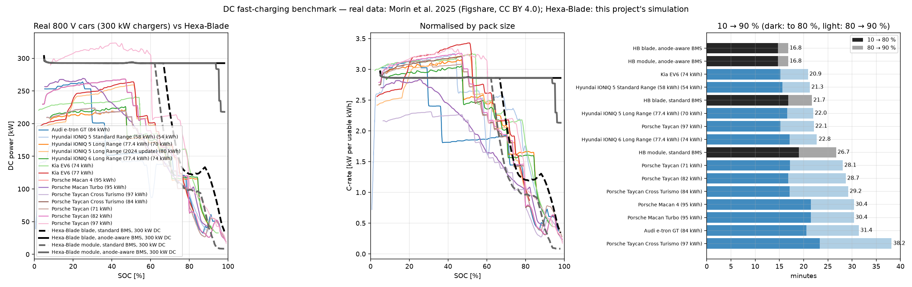
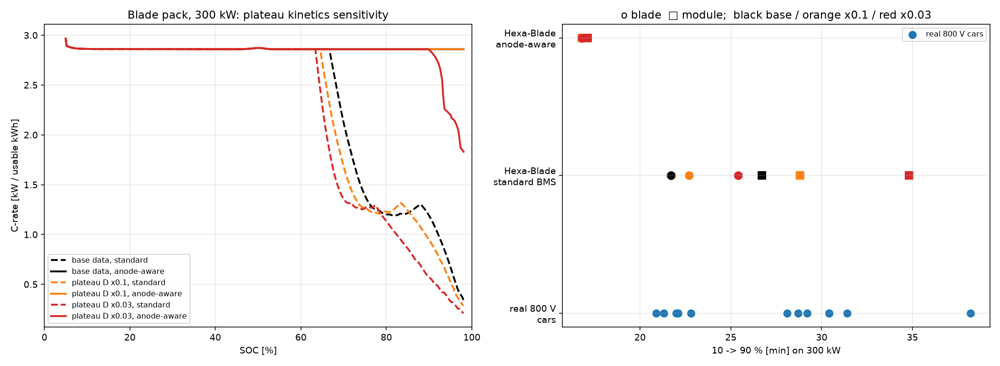

# Benchmark vs real 800 V cars

## Data and license

**Morin, H., Chatra, A., Whitacre, J. F., Michalek, J. (2025).** *Digitized Electric Vehicle Fast-Charging Profiles by Model (Power vs SOC/SOE, CSV Format)*, Version 1. Figshare. https://doi.org/10.6084/m9.figshare.30570653.v1. License **CC BY 4.0**: free to use and adapt with attribution.

The curves were digitized from Fastned and InsideEVs charts (accessed Feb–Jul 2025), mostly on 300 kW chargers, so they are approximations of measured behaviour. The raw files are kept in `external_data/figshare-fastcharge/` with `SOURCE.txt`.

Other sources considered:
- **open-ev-data** (OpenChargingCloud, MIT): clean licence, but last updated July 2020. Its only 800 V entries (Taycan) carry the *estimated default* curve, so it is unusable for this benchmark.
- **ev-database.org**: its terms forbid automated collection, so it was not used.

800 V cars in the benchmark: Porsche Taycan (71 / 82 / 97 kWh, Cross Turismo), Audi e-tron GT, Hyundai Ioniq 5 (54 / 70 / 80 kWh), Ioniq 6, Kia EV6 (74 / 77 kWh) and Porsche Macan Electric. Every time below, real or simulated, is computed the same way from the power-vs-SOC curve: t = ∫ usable·dSOC / P.



## Result 1: the model reproduces real 800 V cars (standard BMS)

| On a 300 kW charger | Peak C-rate | 10→80% | 10→90% | Power taper starts |
|---|---|---|---|---|
| Real 800 V cars (best → typical) | 3.0–3.4C | 15.2–17.2 min | 20.9–29 min | 50–60% SOC |
| Hexa-Blade blade, standard BMS | 3.0C | 16.8 min | 21.7 min | 69% SOC |
| Hexa-Blade module, standard BMS | 2.9C | 19.0 min | 26.7 min | 64% SOC |

With a conventional BMS (40 mV plating margin, pack at 30 °C) the sodium-ion pack charges like the best current 800 V cars. The module pack lands in the slower half because the coldest cell in each parallel group sets the limit.

## Result 2: the anode-aware BMS is beyond every real car, and why

The anode-aware strategy (15 mV margin, pack at 35 °C) holds about 2.9C to 92–98% SOC. That gives **16.8 min for 10→90% on 300 kW, about 4 min faster than the best real car**. No real car in the data holds full power past about 60%.

**Sensitivity to hard-carbon plateau kinetics** (`sensitivity.py`). Published GITT measurements show sodium diffusing 1–2 orders of magnitude more slowly in the hard-carbon "plateau" region than in the sloping region, while the base data dips only about 6×. Diffusion was therefore penalised ×0.1 and ×0.03 above about 55% anode fill:

| Plateau diffusion | Blade, standard | Blade, anode-aware | Module, anode-aware |
|---|---|---|---|
| base data | 21.7 min | 16.8 min | 16.8 min |
| ×0.1 | 22.7 min | 16.8 min | 16.8 min |
| ×0.03 | 25.4 min | 16.8 min | 17.1 min |



**Interpretation.**
- The standard BMS responds to plateau kinetics the way real cars behave, ending up between 22 and 26 min.
- The anode-aware result is robust to diffusion. A full factorial ablation ([../ablation/REPORT.md](../ablation/REPORT.md)) attributes **81–95 % of its advantage to the plating safety margin** (15 mV versus about 40 mV, which reproduces real-car tapers) and the rest to a slightly warmer pack; its relaxed thermal limits and higher C-rate cap contribute nothing at 25 °C, in the cold, or at 35 °C (they only matter in a 45 °C hot-soak at 350 kW).
- Whether a production BMS could run a 15 mV margin is the real open question. A production margin also has to cover:
  - cell aging, since anode overpotential grows with SEI and capacity fade;
  - anode-potential observer error, a few mV;
  - cell-to-cell spread;
  - warranty conservatism (8 years / 160,000 km).

  This is the most likely reason real cars taper at 50–60%. Treat 15–17 min to 90% as a **best case for a new cell with an accurate observer**, and about 22 min (standard BMS) as the conservative, real-world-validated figure.

*Numbers updated for the enlarged cells (blade 64 mm, 204s1p; module 58 mm, 200s4p, October 2026). The conclusions did not change.*

Reproduce:
```bash
.venv/Scripts/python -m ev_pack.charge_maps --plateau-d-factor 0.1    # ~4 min
.venv/Scripts/python -m ev_pack.charge_maps --plateau-d-factor 0.03
.venv/Scripts/python analysis/realcars/benchmark.py
.venv/Scripts/python analysis/realcars/sensitivity.py
```
