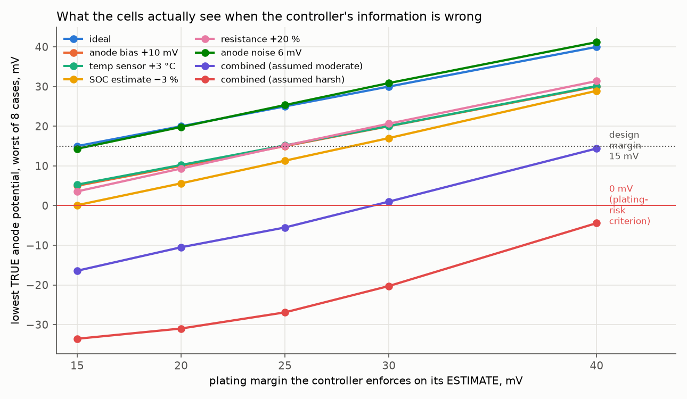
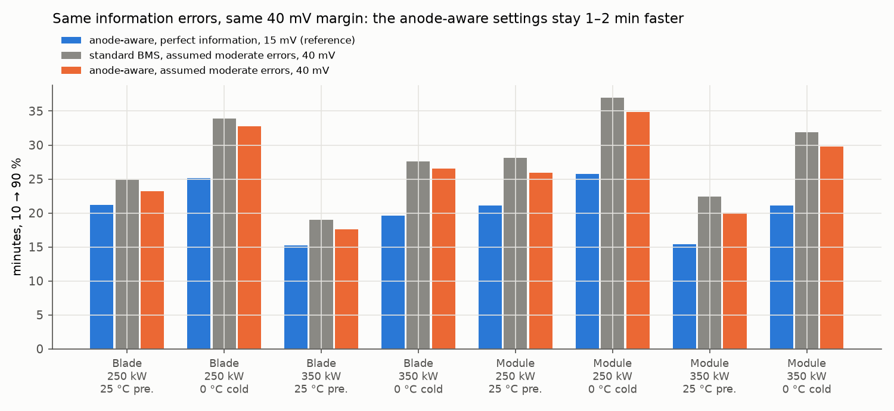
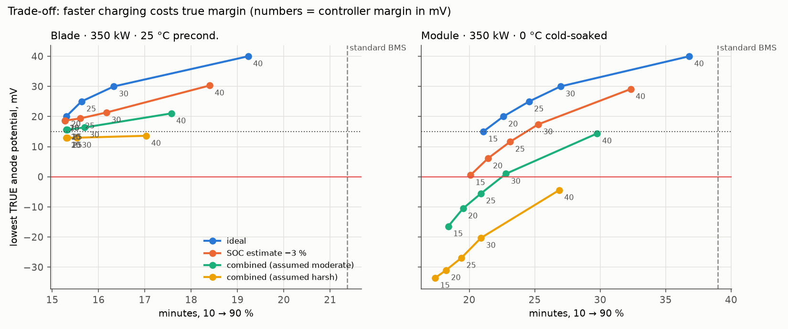

# Imperfect-knowledge stress test: how much of the ideal-information advantage survives?

**Question.** How does charging performance change when the BMS cannot see the true anode potential, and how much of the simulated anode-aware advantage survives under a declared protection target (true modelled anode ≥ 15 mV)?

**Status: simulation stress test.** The errors are *injected* with assumed sizes; no estimator has been built. The combinations are labelled *assumed moderate* and *assumed harsh*: their sizes and joint occurrence are not supported by measurements or specifications, so the results show sensitivity to those assumptions, not the error distribution of a real BMS. 15.3 min (blade, 350 kW, 10 → 90 %) is the *ideal-information simulation reference*.

**Two different thresholds.** Falling below **15 mV** violates the selected safety buffer (a *margin violation*). Crossing **0 mV** crosses the model's *plating-risk criterion*. Neither is evidence that sodium actually deposited; that would need a deposition model or an experiment.

## Set-up: three roles (`ev_pack.pack_sim.InfoErrors`)

- **Controller** sees only declared measurements and estimates: temperature readings (with bias), an SOC estimate, and an anode-potential estimate from its own nominal map model plus bias and noise, optionally delayed. It runs the same limits and bisection as the ideal BMS **on those estimates only**. The true-anode clamp is disabled, and its plating table shares the estimate's bias.
- **Plant** evolves on its true state. A resistance mismatch makes real cells polarise more than the controller's model (true anode = OCP − (1 + r)·(OCP − model anode)), with heat to match.
- **Evaluator** reads the true state: lowest true anode potential, time and depth below 15 mV and below 0 mV, cell over-voltage, target completion, and the **dangerous error direction** (estimate higher, i.e. safer, than truth).

Defaults are unchanged (tests: zero error reproduces the ideal controller exactly; the 336-session matrix values reproduce).

**Cases:** blade and module × 250 and 350 kW × 25 °C preconditioned and 0 °C cold-soaked (8). **Scenarios:** 14. **Anode-aware controller margins:** 15, 20, 25, 30, 40 mV. Runs: 560 sweep + 104 fallback + 112 standard-BMS runs facing the same errors, one seeded simulation each (8 single-threaded workers).

| Scenario | Error (assumed) |
|---|---|
| anode bias | estimate reads +5 / +10 / +15 mV too high (optimistic) |
| anode noise | 3 / 6 mV (1 σ), independent per cell and 2 s step |
| temp sensor | readings +3 °C (optimistic) / −3 °C |
| SOC estimate | −3 % (thinks emptier) / +3 % |
| resistance | real cells polarise 20 % more than the model |
| delay | controller acts on a state 2 steps (4 s) old |
| combined (assumed moderate) | +5 mV bias, 3 mV noise, +2 °C, −2 % SOC, +10 % resistance, 1-step delay |
| combined (assumed harsh) | +10 mV bias, 5 mV noise, +3 °C, −3 % SOC, +20 % resistance, 2-step delay |

## Summary: the answer depends on the operating condition

| Operating condition | What the results show |
|---|---|
| Warm and charger-limited (25 °C preconditioned) | The tested errors have limited effect: the plating guard rarely controls the current, so information quality hardly matters. |
| Cold-soaked and plating-limited (0 °C) | Estimation errors directly reduce the true modelled margin; conservative compensation removes much of the advantage that came from the smaller margin. |
| Single assumed errors | A 20–30 mV controller margin protects the 15 mV target, and the anode-aware controller stays several minutes faster than the standard BMS facing the same error. |
| Assumed moderate combination | Same errors, same 40 mV setting: the anode-aware configuration is still 1–2 min faster, but both end slightly below the 15 mV target, so this is a same-setting comparison, not a protection-matched one. The difference is plausibly from its temperature settings (not tested under errors). |
| Assumed harsh combination | Neither controller holds the 15 mV target at 40 mV; the fallback margin protects it but the charge stalls before 80 % (constraint-respecting, task-incomplete). |
| Changing-current profiles | The reduced cell model is optimistic after sharp current changes; that needs a separate, profile-dependent allowance (see below). |

## Margin each error needs (anode-aware controller, worst of the 8 cases)



| Scenario | Lowest true anode at a 15 mV controller margin | Margin to keep true ≥ 15 mV | Margin to stay ≥ 0 mV | Dangerous error near the limit (max, and how long) |
|---|---|---|---|---|
| ideal | 15.0 mV | 15 mV | 15 mV | 0.0 mV for up to 0 min |
| anode bias +5 mV | 10.0 mV | 20 mV | 15 mV | 5.0 mV for up to 16 min |
| anode bias +10 mV | 5.0 mV | 25 mV | 15 mV | 10.0 mV for up to 15 min |
| anode bias +15 mV | 0.0 mV | 30 mV | 15 mV | 15.0 mV for up to 14 min |
| anode noise 3 mV | 12.6 mV | 20 mV | 15 mV | 9.2 mV for up to 4 min |
| anode noise 6 mV | 14.3 mV | 20 mV | 15 mV | 19.9 mV for up to 8 min |
| temp sensor +3 °C | 5.3 mV | 25 mV | 15 mV | 13.8 mV for up to 16 min |
| temp sensor −3 °C | 20.5 mV | 15 mV | 15 mV | 0.0 mV for up to 0 min |
| SOC estimate −3 % | 0.1 mV | 30 mV | 15 mV | 20.9 mV for up to 15 min |
| SOC estimate +3 % | 8.6 mV | 25 mV | 15 mV | 6.4 mV for up to 7 min |
| resistance +20 % | 3.6 mV | 25 mV | 15 mV | 15.4 mV for up to 17 min |
| delay 2 steps (4 s) | 13.9 mV | 20 mV | 15 mV | 1.8 mV for up to 0 min |
| combined (assumed moderate) | -16.4 mV | > 40 mV | 30 mV | 40.5 mV for up to 16 min |
| combined (assumed harsh) | -33.6 mV | > 40 mV | > 40 mV | 67.6 mV for up to 15 min |

Grid margins only (15, 20, 25, 30, 40 mV); the true requirement can lie between grid points.

- **Single errors need a 20–30 mV margin** to keep the true anode at 15 mV. At a 15 mV margin none crosses 0 mV, though a +15 mV bias and a −3 % SOC error reach it. Optimistic anode bias passes straight through; a +3 °C sensor bias costs about 10 mV, a −3 % SOC error about 15 mV, 20 % extra resistance about 11 mV. Noise and a 4 s delay matter less (the BMS acts on the lowest of hundreds of noisy cell estimates).
- **Errors combine roughly additively.** The assumed moderate set needs about 41 mV to keep 15 mV (worst true anode 14.4 mV at 40 mV) and crosses 0 mV below 30 mV (-16.4 mV at 15 mV). The assumed harsh set crosses 0 mV even at 40 mV (-4.4 mV).
- **The dangerous direction persists:** biased sensors or estimates leave the controller believing the anode is 5–21 mV safer than it is for 15–17 minutes, the stretch of the session near the limit.
- **SOC errors in either direction are risky:** even an SOC estimate 3 % too high costs about 6 mV, because at a fixed current the anode potential is not monotonic in SOC.

## Equal information: standard BMS vs anode-aware BMS facing the same errors

Configured margins are not equivalent protections, so both controllers are compared on what the evaluator measures: true margin, time below 15 mV and 0 mV, completion and charging time. The standard BMS keeps its own settings (40 mV, 30 °C, 45 / 55 °C, 4C).



| Scenario | Controller | Lowest true anode (worst case) | Time below 15 mV (max) | Time below 0 mV (max) | Reached 90 % | 10 → 90 % range (min) |
|---|---|---|---|---|---|---|
| ideal | standard BMS, 40 mV | 40.0 mV | 0 s | 0 s | 8 / 8 | 21.4–43.1 |
|  | anode-aware, 40 mV | 40.0 mV | 0 s | 0 s | 8 / 8 | 19.2–40.9 |
|  | anode-aware, 15 mV | 15.0 mV | 0 s | 0 s | 8 / 8 | 15.3–25.8 |
| temp sensor +3 °C | standard BMS, 40 mV | 30.2 mV | 0 s | 0 s | 8 / 8 | 19.4–38.2 |
|  | anode-aware, 40 mV | 30.1 mV | 0 s | 0 s | 8 / 8 | 17.6–36.5 |
|  | anode-aware, fallback 25 mV | 14.9 mV | 4 s | 0 s | 8 / 8 | 15.3–26.7 |
| SOC estimate −3 % | standard BMS, 40 mV | 29.0 mV | 0 s | 0 s | 8 / 8 | 20.2–38.8 |
|  | anode-aware, 40 mV | 28.9 mV | 0 s | 0 s | 8 / 8 | 18.4–36.9 |
|  | anode-aware, fallback 30 mV | 16.9 mV | 0 s | 0 s | 8 / 8 | 16.2–29.9 |
| resistance +20 % | standard BMS, 40 mV | 31.3 mV | 0 s | 0 s | 8 / 8 | 20.8–41.3 |
|  | anode-aware, 40 mV | 31.4 mV | 0 s | 0 s | 8 / 8 | 18.7–39.2 |
|  | anode-aware, fallback 26 mV | 16.7 mV | 0 s | 0 s | 8 / 8 | 15.6–28.7 |
| combined (assumed moderate) | standard BMS, 40 mV | 14.3 mV | 2 s | 0 s | 8 / 8 | 19.0–37.0 |
|  | anode-aware, 40 mV | 14.4 mV | 4 s | 0 s | 8 / 8 | 17.6–34.9 |
|  | anode-aware, fallback 45 mV | 21.6 mV | 0 s | 0 s | 8 / 8 | 19.8–43.1 |
| combined (assumed harsh) | standard BMS, 40 mV | -5.1 mV | 266 s | 34 s | 8 / 8 | 17.9–34.4 |
|  | anode-aware, 40 mV | -4.4 mV | 252 s | 32 s | 8 / 8 | 17.0–32.3 |
|  | anode-aware, fallback 66 mV | 31.4 mV | 0 s | 0 s | 0 / 8 | — |

- **Assumed moderate errors, equal 40 mV margin:** the anode-aware configuration is 1.1–2.3 min faster than the standard BMS in every case, at the same setting and facing the same errors. **This is a same-setting comparison, not a protection-matched one:** both controllers end slightly below the 15 mV target (worst 14.4 vs 14.3 mV), so it is not evidence of faster charging while meeting the target. A protection-matched comparison would choose each controller's margin on calibration cases and evaluate both on held-out cases against the same true-state criterion. The remaining difference is *plausibly* from the warmer temperature settings (the perfect-information ablation attributes 5–19 % of the gap to them), but that attribution was not re-tested under injected errors; a matched temperature-setting toggle under the same errors would be needed to confirm it.
- **The standard BMS is not automatically protected either.** Facing the same errors it ends at 14.3–19.6 mV true (moderate) and crosses 0 mV under the harsh set (worst -5.1 mV). It also finishes faster than with perfect information, because the errors make it optimistic too.
- **Single errors:** the anode-aware controller with its fallback margin stays several minutes faster than the standard BMS facing the same error, with the 15 mV target held (within 0.1 mV). Most of the advantage survives single errors of these sizes.

## The fallback rule (derived on single errors, tested on held-out combinations)

Each single error's *equivalent anode error* is how far it pushes the true anode below 15 mV at a 15 mV margin (worst case): anode-estimate bias 1.0 mV per mV, anode noise 0.8 mV per mV (1 σ), temperature-sensor bias 3.2 mV per °C, SOC error 5.0 mV per %, resistance mismatch 5.7 mV per 10 %, delay 0.6 mV per 2 s step. **Rule: margin = 15 mV + the sum of the declared errors' equivalents** (45 mV for the assumed moderate set, 66 mV for the assumed harsh set).

| Scenario | Fallback margin | Lowest true anode (8 cases) | Outcome |
|---|---|---|---|
| anode bias +5 mV | 20.0 mV | 15.0 mV | target held, 90 % reached (15.3–25.8 min) |
| anode bias +10 mV | 25.0 mV | 15.0 mV | target held, 90 % reached (15.3–25.8 min) |
| anode bias +15 mV | 30.0 mV | 15.0 mV | target held, 90 % reached (15.3–25.8 min) |
| anode noise 3 mV | 17.4 mV | 14.9 mV | target held, 90 % reached (15.4–27.9 min) |
| anode noise 6 mV | 19.8 mV | 19.6 mV | target held, 90 % reached (16.7–33.1 min) |
| temp sensor +3 °C | 24.7 mV | 14.9 mV | target held, 90 % reached (15.3–26.7 min) |
| temp sensor −3 °C | 24.7 mV | 29.2 mV | target held, 90 % reached (16.5–32.3 min) |
| SOC estimate −3 % | 29.9 mV | 16.9 mV | target held, 90 % reached (16.2–29.9 min) |
| SOC estimate +3 % | 29.9 mV | 25.8 mV | target held, 90 % reached (16.5–33.1 min) |
| resistance +20 % | 26.4 mV | 16.7 mV | target held, 90 % reached (15.6–28.7 min) |
| delay 2 steps (4 s) | 16.1 mV | 15.0 mV | target held, 90 % reached (15.3–26.1 min) |
| combined (assumed moderate) | 45.0 mV | 21.6 mV | target held, 90 % reached (19.8–43.1 min) |
| combined (assumed harsh) | 66.1 mV | 31.4 mV | **constraint-respecting, task-incomplete**: 90 % not reached in any case |

The rule was **empirically successful on the tested combinations**: the true anode stayed at or above 15 mV (within 0.1 mV) in every scenario, including the two held-out combinations. That is not a general safety guarantee: it holds for these error types, sizes and cases. Under the assumed harsh set the 66 mV margin keeps the target but the charge stalls before 80 % in all 8 cases, which counts as constraint-respecting but task-incomplete, not a pass.

## Trade-off: charging time vs true margin



Each line walks the controller margin from 15 to 40 mV (numbers on the points). **Warm and charger-limited (blade, 25 °C preconditioned):** the plating guard rarely binds, so even the assumed moderate errors leave the true anode at 15.7–21 mV at every margin and the harsh set dips to about 13 mV. **Cold-soaked (module, 0 °C):** the guard binds for most of the session and every error turns into lost true margin. The worst-case margins above are set by the cold, plating-limited cases.

Time cost of the margin itself, with perfect information (minutes, 10 → 90 %):

| Case | 15 mV | 20 mV | 25 mV | 30 mV | 40 mV | Standard BMS (perfect information) |
|---|---|---|---|---|---|---|
| Blade · 250 kW · 25 °C precond. | 21.2 | 21.2 | 21.2 | 21.7 | 24.8 | 26.8 |
| Blade · 250 kW · 0 °C cold-soaked | 25.1 | 26.5 | 28.2 | 30.5 | 38.2 | 39.7 |
| Blade · 350 kW · 25 °C precond. | 15.3 | 15.3 | 15.6 | 16.3 | 19.2 | 21.4 |
| Blade · 350 kW · 0 °C cold-soaked | 19.6 | 20.9 | 22.5 | 24.6 | 31.6 | 32.7 |
| Module · 250 kW · 25 °C precond. | 21.1 | 21.2 | 21.9 | 23.1 | 28.5 | 31.8 |
| Module · 250 kW · 0 °C cold-soaked | 25.8 | 27.3 | 29.2 | 31.6 | 40.9 | 43.1 |
| Module · 350 kW · 25 °C precond. | 15.4 | 16.0 | 16.8 | 18.0 | 23.3 | 26.5 |
| Module · 350 kW · 0 °C cold-soaked | 21.1 | 22.6 | 24.6 | 27.0 | 36.8 | 39.0 |

## The reduced cell model's own error: two different measures

The plant here is the pack simulator's reduced (lookup-map) cell model. Its error relative to the full DFN must be reported two ways, because they answer different questions:

- **Pointwise optimistic error** (the map says the anode is safer than the DFN at that moment): 0.5–1.5 mV for smooth anode-aware tapers, up to 5.5 mV for standard tapers (model card); 4–10 mV around current jumps caused by noisy estimates (replays below); up to 50–60 mV after sharp cuts or pulses (model card).
- **Difference between session minima** (map minimum vs DFN minimum): at most 1.4 mV in the replays below, and in 6 of 7 the DFN minimum was higher. Brief optimistic errors can occur away from the session minimum, so this number alone cannot justify a universal allowance.

So the allowance is **profile-dependent**: about 1.5 mV is reasonable for the smooth tapers of the existing controllers; a controller with jumpy current needs 4–10 mV more or a limit on how fast the current may change; controllers that cut, pause or pulse must be evaluated with the full DFN.

| Replayed run | Max C jump | Replay temp | Min anode, map / DFN (mV) | Pointwise map optimism near the limit (max) |
|---|---|---|---|---|
| ideal, 15 mV, blade 350 kW 25 °C | 0.01C | 42.0 °C | 15.1 / 16.0 | 0.0 mV |
| anode noise 6 mV, 15 mV, blade 350 kW 25 °C | 0.92C | 42.0 °C | 21.2 / 22.4 | 3.8 mV |
| anode noise 6 mV, 15 mV, module 350 kW 0 °C | 0.48C | 24.3 °C | 15.8 / 17.1 | 8.7 mV |
| anode noise 3 mV, 15 mV, module 350 kW 0 °C | 0.28C | 23.5 °C | 4.2 / 5.2 | 5.8 mV |
| combined (assumed moderate), 40 mV, blade 350 kW 25 °C | 0.38C | 42.6 °C | 29.9 / 30.3 | 3.6 mV |
| combined (assumed moderate), 40 mV, module 350 kW 0 °C | 0.32C | 25.9 °C | 31.3 / 31.8 | 6.0 mV |
| combined (assumed harsh), 40 mV, blade 350 kW 0 °C | 0.41C | 25.3 °C | 9.2 / 7.8 | 10.4 mV |

Replays use the average cell, isothermally at the session's mean temperature.

## What this does and doesn't show

- **Shows:** a controller–plant–evaluator benchmark that quantifies how estimation uncertainty changes charging performance across charger-limited and plating-limited conditions. Under the assumed errors, the part of the advantage that comes from a smaller plating margin depends on estimator quality; a 1–2 min same-setting difference remains, plausibly from the temperature settings.
- **Doesn't show:** what errors a real estimator achieves (none was built), real-cell behaviour (the plant is the same reduced model; internal-potential validation needs instrumented cells with micro-reference electrodes), actual sodium deposition, or run-to-run variability (one seeded run per case).
- **Assumptions to watch:** error sizes and combinations are assumed; noise is independent per cell; the controller's model and the plant share the same maps except for the resistance mismatch.

## Next bounded experiment

Can a **measurement-only estimator** recover charging performance in cold, plating-limited conditions while keeping the declared modelled protection target? Start with one cell and a limited operating range; compare a simple model-based observer with a small history-based ML estimator using only voltage, current, temperature and declared initialisation information. Judge them on optimistic-error tails, persistent bias, true-state violations, target completion and charging time on held-out sessions and parameter cases, not just average error.

Reproduce:
```bash
.venv/Scripts/python analysis/robustness/run_robustness.py --workers 8   # ~9 min, resumable
.venv/Scripts/python analysis/robustness/dfn_recheck.py
.venv/Scripts/python analysis/robustness/report.py
```
