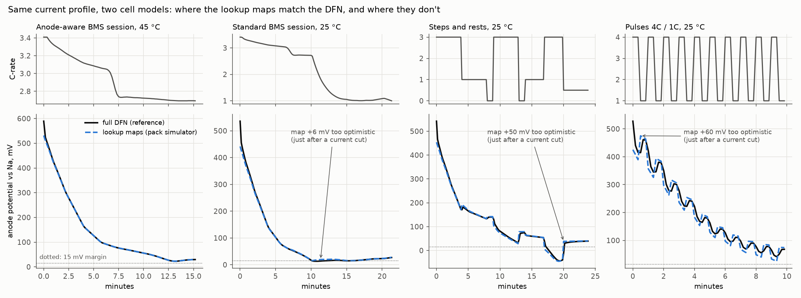

# Model card: HEXA-BLADE sodium-ion cell and pack charging model

**Status: simulation only.** Nothing here has been measured on a real cell. This card says what the model is built
from, where it has been checked, and where it should not be trusted.

## What the headline number is

> The simulated pack reaches 10–90 % in 15.3 minutes with direct access to the modelled internal anode potential and no
> estimation error or delay. This is an **ideal-information (perfect-knowledge) simulation reference**, not demonstrated
> production-BMS performance, and not proof that the controller finds the fastest feasible charge.

## Three validation questions (only the first is addressed here)

| Question | What answering it establishes | Status |
|---|---|---|
| Do the lookup maps reproduce transient DFN behaviour? | Accuracy of the reduced approximation **relative to the DFN model** (model-to-model verification) | **This card** |
| What happens with biased, noisy or delayed information? | Controller sensitivity to assumed information errors | Not done yet (stress-test task) |
| Can an estimator achieve those error levels? | Performance of an implemented estimator on held-out trajectories | Not done |

Agreement between the maps and the DFN is **not** experimental validation of the proposed sodium-ion cell. Published
anode-potential-control work validated internal potential estimates with instrumented cells (micro-reference
electrodes), not with full-cell voltage alone.

## Model structure

1. **Cell physics:** PyBaMM sodium-ion `BasicDFN` (isothermal, one constant temperature per run), NVPF cathode / hard-carbon
   anode, Chayambuka 2022 parameter set, modified by the knobs in `ev_pack/na_cell.py` (`CellDesign`).
2. **Charge maps:** 96 constant-current DFN charges from empty (8 temperatures −20…55 °C × 12 C-rates 0.05…6C) give
   overpotential and anode potential vs Na at the anode/separator boundary as functions of (T, C, SOC)
   (`ev_pack/charge_maps.py`).
3. **Pack simulator:** every cell reads the maps each 2 s step. The **overpotential** follows its map value with a 15 s
   first-order lag; the **anode potential is read instantly** from the map at the present current (`ev_pack/pack_sim.py`).
   The BMS enforces its plating margin on that map value, using the true modelled state (no estimator).

## Parameters: published vs assumed

| Item | Source | Value used |
|---|---|---|
| Open-circuit potentials, max/initial concentrations, electrode balance, electrolyte properties | Published: Chayambuka et al. 2022 (PyBaMM `Chayambuka2022`) | as published |
| Hard-carbon solid diffusivity | **Assumed** | ×40 the lab value |
| NVPF solid diffusivity | **Assumed** | ×10 |
| Reaction rates (both electrodes) | **Assumed** | ×50 |
| Hard-carbon particle radius | **Assumed** | 2.5 µm (lab 3.48 µm) |
| Electrode thickness, anode / cathode | **Assumed** (power-optimised) | 48 / 51 µm (lab 64 / 68 µm) |
| Activation energies (diffusion, kinetics, electrolyte) | **Assumed**, within published Na-ion ranges | 30–55 kJ/mol |
| Cell capacity | **Assumed**: electrode area scaled | 150 Ah reference (147 Ah blade, 37 Ah module cell) |
| Charge cut-off voltage | **Assumed** | 4.3 V |
| Pack thermal conductances, cold-plate contact spread, heater / chiller power | **Assumed**, partly calibrated to Li-ion fleet behaviour (EVBattery) | see `ev_pack/architectures.py`, `pack_sim.py` |
| Tab / busbar resistance, SOC imbalance | **Calibrated** to Li-ion fleet behaviour, not Na-ion data | 0.12 mΩ per 150 Ah cell, 8 mΩ pack, 1 % |

None of the assumed values were tuned to hit a charging-time target.

## Operating range and numerical coverage

- Maps cover −20 to 55 °C and 0.05 to 6C. **91 of 96 DFN runs completed.** The five failures are all at −20 °C:
  **0.05C, 3.5C, 4C, 5C and 6C** (`results/charge_maps.log`). Those points are filled from neighbours, so −20 °C results
  are lower-confidence.
- At high current a constant-current run hits the voltage limit early (at 0 °C: 3C reaches only 43 % SOC, 6C 26 %).
  **Beyond each run's reach the map holds the anode potential flat**, which is optimistic (at 0 °C, 3C, 70 % SOC the map
  says −45 mV, the DFN −137 mV). The pack simulator never operates there: its voltage limit forbids any current whose map
  run did not reach the present SOC, and the plating guard is stricter still (at 0 °C, 72 % SOC: 1.07C allowed by voltage,
  0.25C by a 15 mV margin). **Any other use of the maps, such as a new controller or optimiser, must keep that guard.**

## Dynamic check: maps vs full DFN under the same current

`dynamic_check.py` drives one cell with identical current-vs-time profiles in both models (isothermal, same start: 0.25C
to 12.3 % true SOC, then 5 min rest). Profiles: per-cell C-rate traces of real pack sessions (blade, 350 kW, both BMS
strategies), steps with rests, and 4C/1C pulses, at 0, 25, 35 and 45 °C. Session traces were produced in a pack that
warms from 30–35 °C to about 47 °C, so isothermal 25 °C and 0 °C replays are deliberately harsher than the real session.
**Error sign: map − DFN. Positive = the map thinks the anode is further from plating than it is (the dangerous direction).**



| Profile | Temp | Minutes compared | Voltage error RMS / max (mV) | Anode error RMS (mV) | **Map optimistic, worst (mV)** | Time optimistic > 2 mV | Min anode, map / DFN (mV) |
|---|---|---|---|---|---|---|---|
| Constant 2C | 25 °C | 20.0 | 21 / 111 | 4.4 | **0.2** | 0 % | -19.2 / -19.2 |
| Anode-aware BMS session | 25 °C | 15.3 | 31 / 152 | 7.5 | **1.5** | 0 % | -37.7 / -38.0 |
| Anode-aware BMS session | 35 °C | 15.3 | 25 / 129 | 5.3 | **0.8** | 0 % | -3.1 / -3.3 |
| Anode-aware BMS session | 0 °C | 5.5 (DFN stopped early) | 57 / 261 | 38.2 | **0.0** | 0 % | -40.3 / -28.6 |
| Anode-aware BMS session | 45 °C | 15.3 | 19 / 119 | 3.7 | **0.5** | 0 % | 22.9 / 22.8 |
| Standard BMS session | 25 °C | 21.4 | 26 / 152 | 6.6 | **5.5** | 18 % | 15.0 / 13.2 |
| Standard BMS session | 35 °C | 21.4 | 21 / 130 | 4.5 | **2.8** | 10 % | 36.4 / 36.3 |
| Standard BMS session | 0 °C | 21.4 | 69 / 261 | 33.7 | **85.9** | 54 % | -76.3 / -132.5 |
| Standard BMS session | 45 °C | 21.4 | 16 / 119 | 3.1 | **1.5** | 0 % | 46.5 / 46.3 |
| Steps and rests | 25 °C | 24.0 | 24 / 142 | 7.8 | **50.3** | 21 % | -45.2 / -43.7 |
| Steps and rests | 0 °C | 24.0 | 89 / 353 | 37.2 | **135.3** | 72 % | -44.8 / -136.5 |
| Steps and rests | 45 °C | 24.0 | 16 / 113 | 3.4 | **21.1** | 9 % | 18.4 / 18.2 |
| Pulses 4C / 1C | 25 °C | 10.0 | 42 / 165 | 17.7 | **60.3** | 50 % | 22.1 / 37.6 |
| Pulses 4C / 1C | 0 °C | 10.0 | 130 / 423 | 53.5 | **97.4** | 54 % | -61.9 / -84.1 |
| Pulses 4C / 1C | 45 °C | 10.0 | 27 / 137 | 7.6 | **28.5** | 47 % | 66.4 / 70.2 |

### Findings

1. **For the current profiles the BMS actually produces, the maps are close.** Anode-aware sessions: the map is at most
   1.5 mV optimistic (25–45 °C), and the minimum anode potential agrees within
   0.4 mV. Standard-BMS sessions: at most
   5.5 mV optimistic, during its current taper. **So a cell the simulator holds at
   the 15 mV margin is, by the DFN, at about 13.5–15 mV.** That changes the headline little.
2. **The maps are optimistic right after the current is cut, and pessimistic right after it rises.** The anode is read
   instantly from the constant-current map at the new current, but the real particles still carry the sodium
   concentration gradient built at the previous current. Worst cases: 50 mV after a 3C → 0.5C
   cut (25 °C), 21 mV at 45 °C, 60 mV in 4C/1C pulses at 25 °C,
   far more at 0 °C. The 15 s lag applies only to the overpotential, not to the anode potential.
3. **Consequence:** the reduced model is adequate for the smooth, monotonically tapering currents of the two existing BMS
   strategies at 25–45 °C. It is **not adequate** for controllers that cut current sharply, pause, or pulse (pulse charging,
   MPC with large steps, heat-then-charge schedules with rests). Those must be evaluated with full transient DFN runs, or
   the map model needs an anode-potential lag / diffusion state calibrated against these DFN results.
4. **Cold replays (0 °C) disagree strongly** (tens of mV RMS) because the warm-session currents drive the cell deep into
   plating and beyond the maps' reach. That's outside the region the pack BMS operates in, but it means cold-weather
   *dynamics* are poorly represented by the maps.
5. **Voltage** agrees within 16–42 mV RMS (25–45 °C), with the largest errors at current steps: the 15 s lag is cruder
   than the DFN's relaxation.

## Known limits of this check

- Isothermal on both sides: PyBaMM's sodium `BasicDFN` uses one fixed temperature, so the pack's rising temperature is
  bracketed (25, 35, 45 °C) rather than replayed.
- One cell, average current: real pack cells differ in temperature and current share; the check covers the cell model,
  not the thermal network.
- DFN vs DFN-derived maps: both inherit the same assumed parameters. This measures the approximation error, not how
  close either is to a real cell.

## How to describe results

- 15.3 min (10–90 %, 350 kW): *ideal-information simulation reference*.
- About 21–22 min (standard BMS, 40 mV margin): the conservative simulated figure, consistent with real 800 V cars.
- Effective DFN margin when the simulator holds 15 mV: about 13.5–15 mV for the existing BMS profiles.

Reproduce:
```bash
.venv/Scripts/python analysis/validation/dynamic_check.py --workers 6   # ~1 min
.venv/Scripts/python analysis/validation/report.py
```
